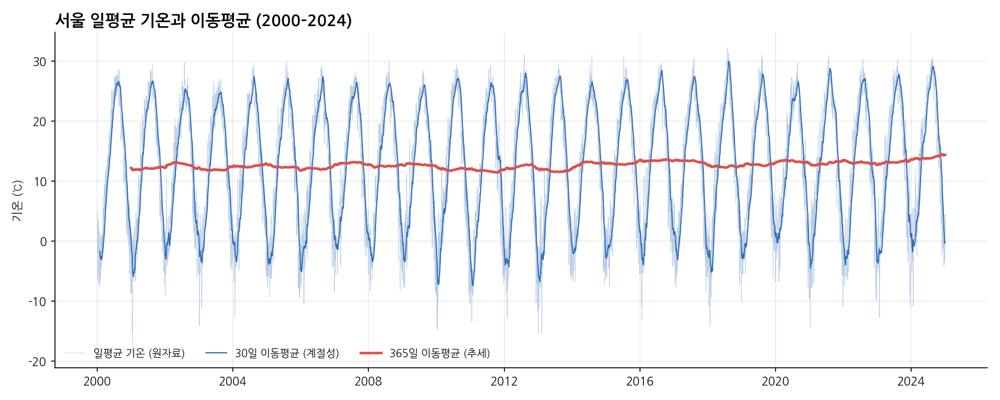
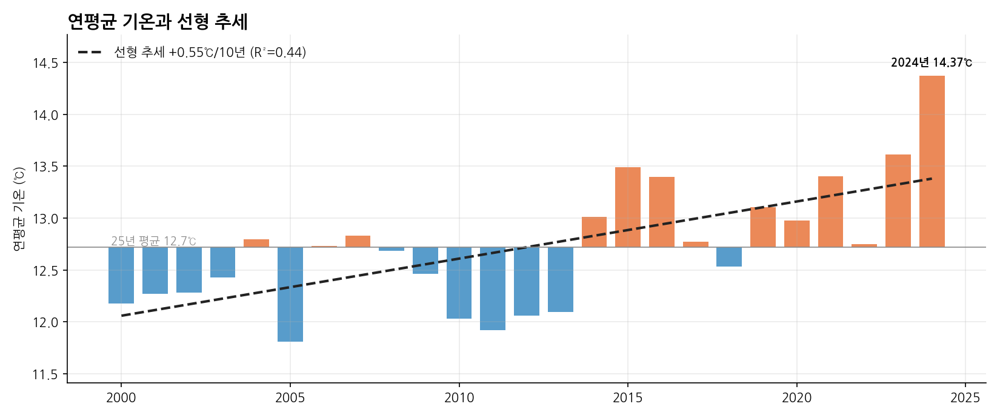
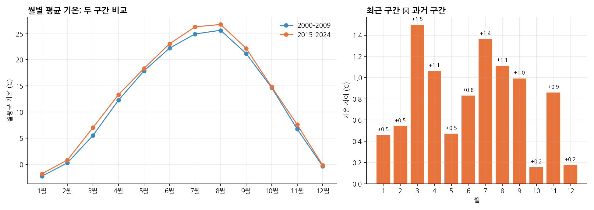
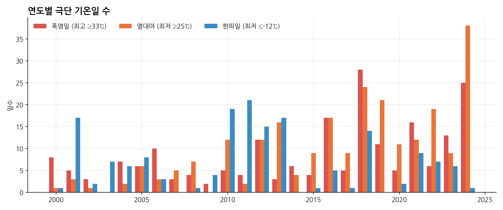
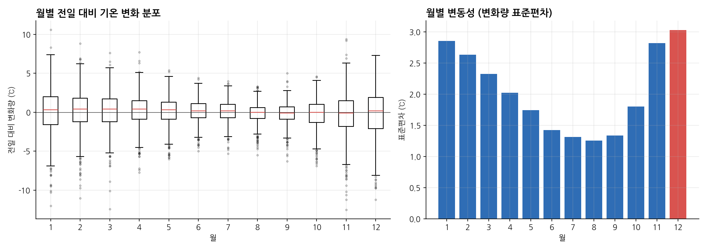
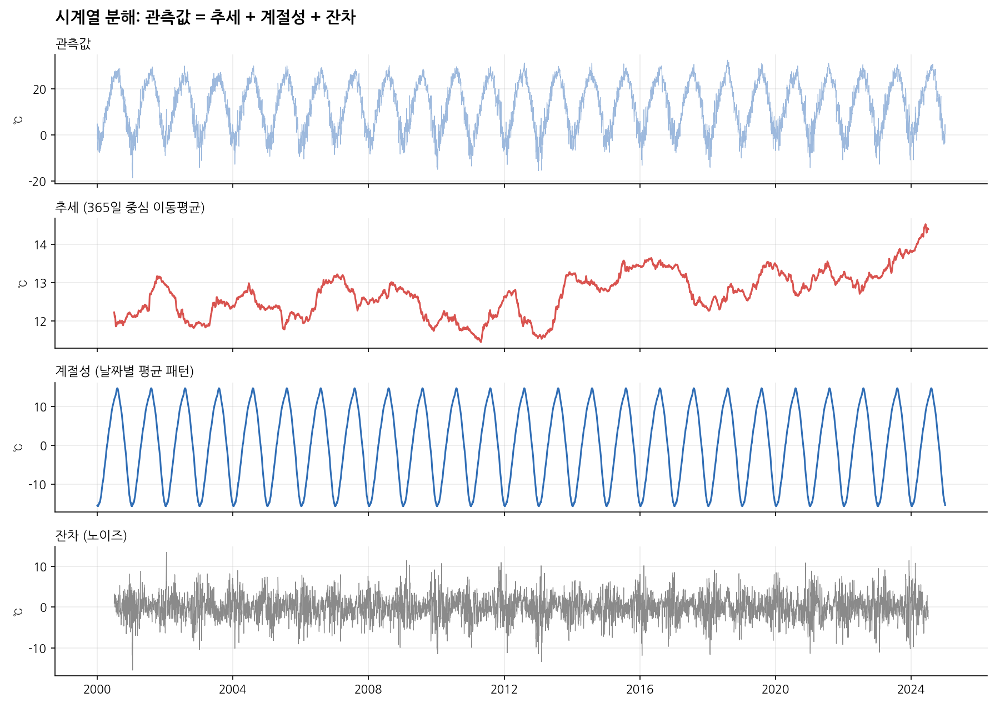
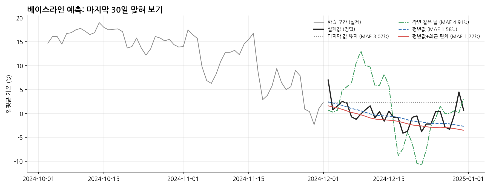
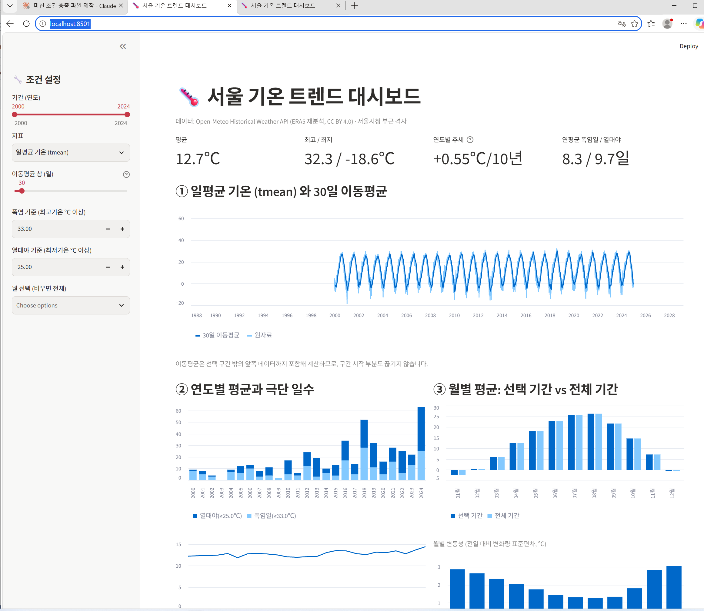
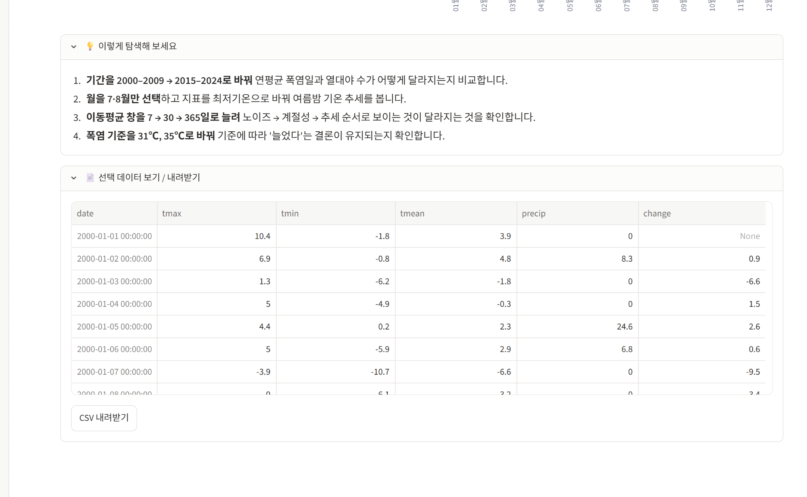

# 🌡️ 서울 기온의 장기 변화 분석 (2000–2024)

**“서울은 정말 더워졌을까?”** 서울 주변의 일별 기온 자료를 이용해 장기 변화, 계절별 차이, 폭염·열대야, 하루 사이 기온 변동을 살펴본 데이터 분석 프로젝트입니다.

> **처음 보시는 분께:** 이 문서만 읽어도 프로젝트의 목적, 데이터의 의미, 그래프를 읽는 방법, 실행 순서를 이해할 수 있도록 정리했습니다. 분석 근거와 한계는 [REPORT.md](REPORT.md)에 더 자세히 기록되어 있습니다.

**핵심 결과** · 2000-01-01~2024-12-31 **9,132일** · 분석 질문 **4개** · 그래프 **7개** · 분석 인사이트 **4개** · 보너스 **시계열 분해 + 기초 예측 + 대시보드**

| 무엇을 알아봤나요? | 분석 결과 | 어떻게 해석해야 하나요? |
|---|---|---|
| 25년간 평균 기온 변화 | 연평균 기준 약 **+0.55℃/10년** | 이 자료·기간에서 계산한 선형 추세입니다. 원인을 증명하는 수치는 아닙니다. |
| 과거 10년과 최근 10년 | 12개월 모두 최근 구간이 더 높음 | 가장 큰 차이는 **3월 +1.50℃**, 가장 작은 차이는 **10월 +0.16℃** |
| 기준 초과 고온일 | 최고 ≥33℃인 날 연평균 **4.8 → 13.0일** | ERA5 격자 기온으로 센 ‘기준 초과 일수’로, 기상청 공식 발표 일수와 다를 수 있습니다. |
| 하루 사이 변동성 | **12월 3.03℃**, **8월 1.26℃** | 하루 전보다 기온이 얼마나 크게 달라졌는지의 표준편차입니다. |

📄 [쉬운 설명을 보강한 분석 보고서](REPORT.md) · 📖 [동료평가용 용어·분석기법 안내](docs/동료평가_쉬운설명_용어와_분석기법.md) · 🧪 [시계열 분해 설명](docs/DECOMPOSITION_GUIDE.md) · 🖥️ [대시보드 사용·증빙 안내](docs/DASHBOARD.md) · 📁 [데이터 출처·변수 설명](data/README.md)

---

## 1. 왜 이 분석을 했을까요?

“요즘은 예전보다 덥다”라는 인상이 실제 기록에서도 나타나는지 확인하기 위해 시작했습니다. 하루 날씨는 오르락내리락하므로 **짧은 변동과 장기적인 변화를 구분**해야 합니다. 이를 위해 하루, 월, 연도 단위로 데이터를 다시 살펴봤습니다.

| 분석 질문 | 왜 중요한가요? | 사용한 방법 |
|---|---|---|
| **Q1. 서울의 평균 기온이 올랐을까?** | 단순히 더운 며칠이 아니라 장기간 변화인지 알아보기 위해 | 365일 이동평균, 연평균과 선형 추세 |
| **Q2. 모든 달이 비슷하게 변했을까?** | 연평균만 보면 어느 계절이 달라졌는지 알기 어려워서 | 2000–2009년과 2015–2024년 월별 평균 비교 |
| **Q3. 폭염일·열대야에 변화가 있을까?** | 평균이 조금 변해도 불편을 겪는 날은 더 크게 달라질 수 있어서 | 일 최고·최저기온의 임계값 초과 일수 |
| **Q4. 기온이 가장 크게 흔들리는 달은?** | 같은 평균이라도 날마다 변하는 정도가 다를 수 있어서 | 전일 대비 기온 차이, 월별 표준편차 |

**해석 원칙:** *관찰(Fact)*은 그래프에서 확인한 수치, *원인 가설(Why)*은 가능한 설명, *후속 조치(Action)*는 추가 검증·활용 제안입니다. 세 가지를 혼동하지 않았습니다.

## 2. 어떤 데이터를 사용했나요?

- **제공 서비스:** [Open-Meteo Historical Weather API](https://open-meteo.com/en/docs/historical-weather-api)
- **자료의 기반:** 유럽중기예보센터(ECMWF)의 **ERA5 재분석** 자료
- **장소:** 서울시청 부근을 대표하는 **기상 격자** (요청 좌표: 북위 37.5665°, 동경 126.9780°)
- **기간:** 2000년 1월 1일~2024년 12월 31일, 매일 1개 기록, **9,132행**
- **원본 보관 위치:** [`data/seoul_weather_2000_2024.csv`](data/seoul_weather_2000_2024.csv)
- **수집 조건 기록:** [`data/metadata.json`](data/metadata.json), 상세 안내는 [`data/README.md`](data/README.md)

| CSV 열 이름 | 뜻 | 단위 | 사용하는 이유 |
|---|---|---|---|
| `date` | 날짜 | 연-월-일 | 시간순 정렬과 연·월별 분석 |
| `tmean` | 하루 평균 기온 | ℃ | 장기 상승·하락 추세 확인 |
| `tmax` | 하루 최고 기온 | ℃ | 기준 이상의 더운 날 계산 |
| `tmin` | 하루 최저 기온 | ℃ | 열대야에 가까운 고온일 계산 |
| `precip` | 하루 강수량 | mm | 원자료에 포함한 참고 변수(이번 주요 결과는 기온 중심) |

**중요:** 이 자료는 서울 한 관측소의 실측 일지가 아니라 **격자 기반 재분석 자료**입니다. 기상청 관측소의 공식 기온·열대야·폭염 일수와 수치가 다를 수 있습니다. 열대야는 공식적으로 야간 시간대의 최저기온을 기준으로 하지만, 이 분석에서는 **일 최저기온 ≥25℃**로 근사했습니다. ‘폭염일’도 일 최고기온 ≥33℃라는 분석 기준이지 공식 폭염특보 발령 건수가 아닙니다.

## 3. 처음 보는 용어부터 이해하기

**동료평가를 준비한다면** 여기의 용어표와 함께 [동료평가용 쉬운 설명](docs/동료평가_쉬운설명_용어와_분석기법.md)을 읽어 보세요. 각 방법의 뜻뿐 아니라 **왜 그 방법을 선택했는지**, 관련 그래프를 어떻게 읽는지까지 설명했습니다. `REPORT.md`에도 같은 방식으로 직접 보충했으며, `python analysis.py`로 다시 생성해도 설명이 유지됩니다.

| 용어 | 쉬운 뜻 | 이 프로젝트에서 왜 사용하나요? |
|---|---|---|
| **시계열 데이터** | 날짜·시간 순서가 있는 기록 | 하루씩 달라지는 기온의 변화를 보려고 |
| **추세(Trend)** | 오랜 기간에 걸친 전반적인 상승·하락 | 서울 기온이 장기적으로 바뀌었는지 보려고 |
| **계절성(Seasonality)** | 여름에 덥고 겨울에 추운 것처럼 일정 주기로 반복되는 패턴 | 매년 반복되는 변화를 장기 추세와 구분하려고 |
| **노이즈(Noise)** | 그날그날의 불규칙한 흔들림 | 일별 기온만 보면 장기 추세를 읽기 어려워서 |
| **이동평균** | 최근 며칠씩 묶어 평균을 계속 계산 | 짧은 날씨 변동을 완화하려고(30일·365일) |
| **선형 추세 / 회귀** | 여러 해의 값에 가장 잘 맞는 직선을 그리는 방법 | 10년당 얼마나 변했는지 수치로 표현하려고 |
| **전일 대비 변화량** | 오늘 기온 − 어제 기온(℃) | 하루 사이 기온이 얼마나 달라졌는지 보려고 |
| **표준편차** | 값이 평균을 중심으로 얼마나 퍼져 있는지 | 어느 달에 기온 변동이 큰지 비교하려고 |
| **결측치** | 비어 있는 측정값 | 없는 값을 임의로 채우면 결과가 왜곡될 수 있어서 |
| **보간** | 앞뒤 값을 참고해 빈 칸을 추정해서 채우기 | 짧은 공백만 보완하되 긴 공백은 남기려고 |
| **이상치** | 평소와 통계적으로 크게 다른 값 | 극한 기온인지, 자료 오류인지 구분해 살펴보려고 |
| **재분석 자료(ERA5)** | 관측과 수치 모델 등을 종합해 과거 날씨를 격자로 재구성한 자료 | 여러 해를 같은 조건에서 비교하려고 |
| **격자** | 지도를 일정한 칸으로 나누어 표현한 위치 | 특정 관측소 실측과 차이가 날 수 있음을 알리려고 |
| **시계열 분해** | 하나의 시계열을 추세·계절성·잔차로 나누기 | 반복되는 계절 변화 속에 장기 변화를 드러내려고 |
| **잔차(Residual)** | 추세와 계절성으로 설명되지 않은 나머지 | 예상 패턴과 다른 일별 변화가 얼마나 큰지 보려고 |
| **베이스라인 예측** | 복잡한 모델을 쓰기 전 비교하는 간단한 예측 | 단순 규칙이 얼마나 맞는지 확인하려고 |
| **MAE(평균절대오차)** | 예측과 실제의 차이를 절댓값으로 평균한 수치 | 숫자가 작을수록 이번 예측 실험에서 오차가 적음을 나타내려고 |
| **대시보드** | 기간·지표 등을 변경하면서 결과를 보는 웹 화면 | 그래프를 고정된 그림 이상으로 탐색하려고 |

예를 들어, **기온이 0.5℃에서 1℃가 되었다**고 ‘100% 상승’이라고 표현하면 기온 단위의 성질 때문에 오해하기 쉽습니다. 따라서 이번 분석은 **전날보다 몇 ℃ 달라졌는지**를 사용합니다.

## 4. 데이터는 어떻게 정리했나요?

원자료를 바로 그리는 대신 `analysis.py`에서 아래 순서로 확인합니다.

1. **중복 날짜 확인:** 같은 날짜가 여러 번 있으면 한 날짜를 한 번만 사용합니다. **왜?** 하루 값이 반복 계산되는 일을 막으려고.
2. **날짜 순서·누락일 확인:** 시작일부터 끝일까지 일별 간격을 맞춥니다. **왜?** 시간순 분석에서 순서가 틀리면 결과도 달라지므로.
3. **측정값 범위 확인:** 정해 둔 범위(-35~45℃) 밖의 기온 또는 음수 강수량은 검토 대상 결측치로 처리합니다. **왜?** 잘못된 입력으로 평균이 왜곡되지 않도록.
4. **논리 오류 확인:** 최저기온이 최고기온보다 높으면 해당 값을 결측으로 처리합니다. **왜?** 서로 모순되는 자료이므로.
5. **짧은 공백 보간:** 연속 **3일 이하**의 기온 결측만 앞뒤 날짜를 참고해 채우고 긴 공백은 남깁니다. **왜?** 없는 장기 패턴을 임의로 만들지 않으려고.
6. **통계적 이상치는 보존:** 평년값 대비 약 **4 표준편차 이상** 차이 나는 날은 표시하지만 삭제하지 않습니다. **왜?** 실제 폭염·한파일 수 있기 때문.

현재 포함된 CSV를 분석하면 날짜 중복 및 결측 없이 **9,132일**이 수록되어 있습니다. 위 규칙은 현재 자료의 품질을 검증하고 이후 다시 수집한 자료를 동일한 방법으로 처리하기 위한 것입니다.

## 5. 그래프 7개를 순서대로 읽는 방법

아래 그래프는 모두 **제출 ZIP에 포함된 로컬 파일**입니다. 다른 사이트의 이미지 주소에 의존하지 않도록, README와 같은 저장소 안의 `images/` 경로로 연결했습니다. 그래프에는 제목뿐 아니라 **무엇을 봐야 하는지**와 **왜 그 방법을 썼는지**를 적었습니다.

### 그림 1. 일별 기온과 30일·365일 이동평균 — Q1



**무엇을 보나요?** 하루 기온은 계절과 날씨에 따라 크게 흔들리지만, 365일 이동평균에서는 천천히 변하는 흐름을 읽기 쉬워집니다. **왜 이동평균인가요?** 여러 날을 묶으면 하루의 우연한 변동을 완화할 수 있기 때문입니다. 30일은 계절의 흐름을, 365일은 1년 주기의 영향을 완화한 장기 흐름을 확인하는 데 사용했습니다.

### 그림 2. 연평균 기온과 추세선 — Q1



**무엇을 보나요?** 연도별 기온과 추세선이 함께 표시됩니다. 이 자료에서 연평균 기온은 약 **10년에 +0.55℃** 상승하는 선형 추세를 보였습니다. **왜 연평균을 계산하나요?** 매년 반복되는 계절 차이를 하나의 연도 값으로 요약하여 장기 변화를 비교하기 쉽기 때문입니다. *추세선은 이 기간의 요약이며 상승 원인 자체를 증명하지는 않습니다.*

### 그림 3. 과거 10년과 최근 10년의 월평균 비교 — Q2



**무엇을 보나요?** 2000–2009년과 2015–2024년의 월별 기온을 비교합니다. **3월 +1.50℃**로 차이가 컸고 **10월 +0.16℃**로 작았습니다. **왜 두 기간을 비교하나요?** ‘연평균 상승’만으로는 어느 계절이 가장 크게 달라졌는지 알 수 없기 때문입니다. 중간 2010–2014년은 비교 구간에서 제외했습니다.

### 그림 4. 해마다 기준을 넘은 더운 날·추운 날 — Q3



**무엇을 보나요?** 최고기온 ≥33℃, 최저기온 ≥25℃, 최저기온 ≤-12℃에 해당하는 **연도별 일수**입니다. 과거 10년과 최근 10년의 평균을 비교하면 ≥33℃인 날이 **4.8→13.0일**, 일 최저 ≥25℃인 날이 **2.8→16.9일**입니다. **왜 임계값을 쓰나요?** 평균만 보면 실제로 고온·저온 기준을 넘는 날이 얼마나 달라졌는지 알기 어렵기 때문입니다. *공식 특보 횟수나 기상청 공식 열대야 통계로 간주하지 마세요.*

### 그림 5. 하루 사이 기온의 변동성 — Q4



**무엇을 보나요?** 하루 전과 비교한 기온 변화 폭을 월별로 비교합니다. 표준편차가 **12월 약 3.03℃**로 가장 크고 **8월 약 1.26℃**로 가장 작았습니다. **왜 표준편차인가요?** 월평균이 비슷해도 매일 흔들리는 폭은 다를 수 있기 때문입니다. 왼쪽 상자그림은 값의 분포를, 오른쪽 막대는 변동성 크기를 보여 줍니다.

### 그림 6. 시계열 분해 — 추세·계절성·잔차를 따로 보기 (보너스)



**무엇을 보나요?** 위에서부터 **① 원래 기온 ② 장기 추세 ③ 매년 반복되는 계절 패턴 ④ 추세·계절성으로 설명되지 않은 잔차**입니다. **왜 분해하나요?** 여름·겨울 차이가 매우 커서 일별 원자료만으로 장기 상승을 읽기 어렵기 때문입니다.

이 프로젝트에서는 직접 구현한 **고전적 가법 분해**를 사용했습니다.

> **관측값 = 추세 + 계절성 + 잔차**

- **추세:** 앞뒤 약 1년의 기온을 이용한 **365일 중심 이동평균**
- **계절성:** 날짜별(365일 주기) 반복 패턴을 평균해 구한 값
- **잔차:** 관측값에서 앞의 두 요소를 뺀 나머지

**결과 해석:** 계절성의 진폭은 약 **30.3℃**, 분해한 추세의 변동 폭은 약 **3.1℃**, 잔차의 표준편차는 약 **2.9℃**입니다. *계절 변화가 장기 추세보다 훨씬 크게 보이므로, 따로 분리해야 장기 변화를 읽기 쉽다*는 뜻입니다. 단, 이 방법은 원인을 규명하는 분석이 아니며, 윤년·양 끝 날짜·분해 방식에 따른 한계가 있습니다. 자세한 계산 순서와 검증 명령은 **[보너스 시계열 분해 가이드](docs/DECOMPOSITION_GUIDE.md)**에서 확인하세요.

### 그림 7. 간단한 기온 예측 방법 4종 비교 (추가 보너스)



**무엇을 보나요?** 마지막 **30일**의 실제 기온과 네 가지 간단한 예측 방법을 비교합니다. **왜 예측하나요?** 추세·계절성 등 분석한 정보가 실제 예측에 도움이 되는지 확인하기 위해서입니다.

| 방법 | 쉽게 말하면 | 이번 실험 MAE |
|---|---|---:|
| 평년값 | 이전 연도들에서 같은 날짜의 평균적 기온 | **1.58℃** |
| 평년값 + 최근 편차 | 평년값에 최근 7일의 따뜻함·추움 정도를 반영 | 1.77℃ |
| 마지막 값 유지 | 내일도 오늘과 같다고 가정 | 3.07℃ |
| 작년 같은 날 | 지난해 같은 날짜의 기온을 그대로 사용 | 4.91℃ |

**주의:** 시험 기간이 2024년 12월의 한 구간이므로 보편적인 예측 성능 순위가 아닙니다. 여러 기간에 반복 시험해야 신뢰할 수 있습니다.

## 6. 브라우저에서 직접 조건을 바꾸는 대시보드 (보너스)

**대시보드(Dashboard)**는 고정된 그래프를 보는 데서 나아가 **기간·지표·월·이동평균 길이·고온 기준**을 직접 바꿔 볼 수 있는 웹 화면입니다. 개발 도구는 **Streamlit**(Python만으로 데이터를 웹 화면에 표시하는 라이브러리)입니다.

### 대시보드 사진 1. 전체 화면 — 분석 결과 한눈에 보기



**사진 설명:** 화면 왼쪽에서 분석 조건을 선택하고, 오른쪽에서 핵심 지표와 시간별·연도별·월별 그래프를 봅니다. *왜 필요한가요?* 보고서의 결론이 특정 연도나 기준에만 해당하는지 사용자가 직접 확인할 수 있기 때문입니다.

### 대시보드 사진 2. 데이터 확인 및 CSV 내려받기



**사진 설명:** 선택한 기간의 데이터를 표로 확인하고 CSV 파일로 내려받을 수 있습니다. *왜 필요한가요?* 그래프의 수치를 사용자가 직접 재확인하고 다른 도구에서도 활용할 수 있도록 하기 위해서입니다.

**실행 명령:**

```powershell
python -m streamlit run dashboard.py
```

브라우저에서 `http://localhost:8501`을 열어 확인합니다. 이 주소는 **사용자 PC에서 실행할 때만 접속되는 로컬 주소**이며, 외부 배포 URL이 아닙니다.

**추천 검증 시나리오:** 기간을 `2000–2009`와 `2015–2024`로 차례로 바꿔 폭염일·열대야 수를 비교하거나, **7·8월만 선택한 뒤 `tmin`(최저기온)**을 선택해 여름밤 기온 변화를 살펴보세요. 상세한 조작 및 제출 증빙 안내는 [docs/DASHBOARD.md](docs/DASHBOARD.md)입니다.

> **증빙 범위:** 제공된 사진 2장은 대시보드 화면과 데이터 표시 기능을 보여 줍니다. **모든 필터 변경 시나리오를 실제 실행했다는 증빙까지 포함된 것은 아닙니다.** 보너스 평가에서 기간·조건 변경 증빙을 요청하면 해당 화면을 추가 촬영해야 합니다.

## 7. 다운로드한 프로젝트 실행 방법

**준비:** Python **3.10 이상**과 인터넷 연결(처음 데이터를 다시 수집할 경우), `requirements.txt`에 적힌 라이브러리가 필요합니다. 제공된 ZIP에는 **이미 CSV와 결과 그래프가 있으므로 API를 다시 호출하지 않아도 됩니다.**

### Windows 10 / VS Code / PowerShell

압축을 풀고 `README.md`가 있는 폴더에서 터미널을 여세요.

```powershell
# ① 현재 프로젝트 폴더에 있는지 확인
Get-ChildItem

# ② 필요한 Python 라이브러리 설치
python -m pip install -r requirements.txt

# ③ 분석 재실행 (기존 CSV 사용, 인터넷 호출 없음)
python analysis.py

# ④ 분해 결과 검증 (추가한 자동 점검)
python -m unittest discover -s tests -v

# ⑤ 대시보드 보기 (선택 사항)
python -m streamlit run dashboard.py
```

**GitHub에서 직접 복제하는 경우** 원본 프로젝트의 주소는 다음과 같습니다. 원본 저장소에는 이 개선본이 아직 반영되지 않았으므로, 복제만 하면 위에서 제공한 개선 README가 나타나지는 않습니다.

```powershell
git clone https://github.com/Yong4478/AI-M1-1.git
cd AI-M1-1
```

### macOS / Linux

`python` 명령이 없다면 아래처럼 `python3`를 사용하세요.

```bash
python3 -m pip install -r requirements.txt
python3 analysis.py
python3 -m unittest discover -s tests -v
python3 -m streamlit run dashboard.py
```

**수집 원자료를 새로 받을 때만** `python fetch_data.py`를 실행합니다. 이 명령은 인터넷을 사용하고 기존 CSV를 새 데이터로 덮어쓸 수 있습니다. 또한 `analysis.py`를 다시 실행하면 **`REPORT.md`를 자동으로 재생성하므로, 직접 편집한 문장이 있다면 먼저 백업**해 주세요. 수집 프로그램은 API 오류 시 모델 지정 없이 재시도할 수 있으므로, **재수집했다면 `data/metadata.json`의 `request.model`이 `era5`인지 반드시 확인**해 기존 비교 조건이 유지되었는지 점검하세요.

| 파일 / 명령 | 무엇을 하나요? | 왜 필요한가요? |
|---|---|---|
| `fetch_data.py` | Open-Meteo에서 일별 자료 수집 | 데이터 출처를 다시 확인하고 수집하기 위해 |
| `analysis.py` | 정제, 통계, 그래프 7장과 보고서 작성 | 모든 결과를 동일한 방법으로 다시 만들기 위해 |
| `dashboard.py` | 웹 대시보드 실행 | 기간·조건을 바꿔 결과를 확인하기 위해 |
| `tests/test_decomposition.py` | 데이터·분해 결과 일관성 검증 | 보너스가 코드와 실제 자료에서 계산되는지 확인하기 위해 |
| `requirements.txt` | 필요한 라이브러리 목록 | 다른 PC에서도 설치·실행할 수 있도록 |

## 8. 프로젝트 폴더 구조와 중복 파일 정리

```text
AI-M1-1_양선재_개선본/
├── README.md                  # 초보자용 프로젝트 안내 (지금 읽는 파일)
├── REPORT.md                  # 수치·그래프·인사이트가 있는 상세 분석 보고서
├── analysis.py                # 데이터 정제·분석·그래프 7장·REPORT 생성
├── fetch_data.py              # 원자료 수집 (필요할 때만 실행)
├── dashboard.py               # Streamlit 보너스 대시보드
├── requirements.txt           # Python 라이브러리 목록
├── .gitignore                 # 임시 생성 파일 제외 규칙
├── data/
│   ├── README.md              # 원자료 정의 및 라이선스
│   ├── metadata.json          # 실제 API 요청 조건
│   └── seoul_weather_2000_2024.csv
├── images/                    # 분석 그래프 7개: 각 파일 한 번만 보관
│   ├── 01_daily_temperature_moving_average.png
│   ├── 02_annual_mean_trend.png
│   ├── 03_monthly_period_comparison.png
│   ├── 04_extreme_days_per_year.png
│   ├── 05_daily_change_volatility.png
│   ├── 06_decomposition.png
│   └── 07_baseline_forecast.png
├── results/
│   ├── annual_stats.csv       # 연도별 계산 결과
│   └── summary.json           # 통계 요약·검증용 값
├── docs/
│   ├── DASHBOARD.md           # 실제 증빙 사진과 추가 시연 방법
│   ├── DECOMPOSITION_GUIDE.md # 분해 보너스 설명·한계·검증
│   ├── 동료평가_쉬운설명_용어와_분석기법.md # 처음 보는 평가자를 위한 상세 해설
│   ├── IMPROVEMENTS.md        # 원본에서 정리한 내용
│   └── images/
│       ├── 01_dashboard_overview.png
│       └── 02_dashboard_data_download.png
└── tests/
    └── test_decomposition.py  # 간단한 자동 검증
```

**중복 정리 기준:** 바깥 ZIP 안에 다시 들어 있던 `seoul-temperature-analysis.zip`, 그래프만 복제해 넣은 ZIP, 동일한 증명사진의 두 번째 사본, 버전관리 내부 폴더 `.git/`, Python 캐시 `__pycache__/`는 개선본에 넣지 않았습니다. **원본 분석 코드·CSV·그래프 7장·REPORT·결과값은 유지**했습니다.

## 9. 보너스와 평가 요구사항 대조

| 과제 조건 | 제출 자료에서 확인할 곳 |
|---|---|
| 시계열 데이터 100개 이상 및 출처·기간 | 9,132행 CSV, 2장, `data/README.md` |
| 질문 3개 이상 | Q1~Q4 (1장) |
| 결측치·이상치 처리 설명 | 4장과 `REPORT.md` 3장 |
| 분석 기법 2가지 이상 | 이동평균, 연평균 추세, 기간 비교, 변동성 등 |
| 그래프 2개 이상 | 5장의 그래프 **7장** |
| 인사이트 3개 이상과 사실·해석 구분 | `REPORT.md`의 인사이트 **4개** |
| Python 코드와 실행 방법 | `analysis.py`, 7장 |
| AI 사용 로그 | `REPORT.md` 7장(최종 확인 필요 사항 포함) |
| **보너스: 시계열 분해** | `analysis.py`의 `decompose()`, 그래프 6, 보너스 가이드 |
| **보너스: 예측** | `baseline_forecast()`, 그래프 7 |
| **보너스: 대시보드** | `dashboard.py`, 사진 2장, `docs/DASHBOARD.md` |

> **AI 사용 로그 주의:** 원본 `REPORT.md`에는 일부 검증 확인란 `[ ]`이 남아 있습니다. 이를 실제 검증한 것처럼 임의로 `[x]`로 바꾸지 않았습니다. **제출 전 실제 수행한 작업에 맞게 작성자가 확인**해야 합니다.

## 10. 분석의 한계 및 데이터 출처 표기

- 이 자료는 **ERA5 재분석 격자값**이지 서울의 모든 지점을 대표하는 공식 관측소 측정값이 아닙니다.
- 25년의 추세가 보인다고 해서 그 **원인을 하나로 확정**할 수 없습니다. 장기간의 추가 관측·비교 분석이 필요합니다.
- **시계열 분해**는 ‘반복되는 계절 패턴’을 추정해 나누는 방법으로, 계절 변화가 매해 완전히 같다는 의미는 아닙니다.
- **예측 오차**는 2024년 12월 한 번의 비교 결과일 뿐입니다.
- README의 사진은 현재 저장된 그래프·캡처입니다. 새로 분석해 결과가 바뀌면 숫자와 설명도 함께 확인해야 합니다.

**출처 및 라이선스**

- Weather data by [Open-Meteo.com](https://open-meteo.com/), licensed under [CC BY 4.0](https://creativecommons.org/licenses/by/4.0/).
- Generated using Copernicus Climate Change Service information (ERA5 reanalysis).
- 수집 서비스 무료 API 사용 조건은 서비스 정책을 확인하고, 상업적 사용 시 별도 조건을 점검하세요.
- 원자료의 구체적인 수집 URL과 단위는 [`data/metadata.json`](data/metadata.json)을 참고하세요.

---

**정리:** 이 프로젝트의 핵심은 “서울이 더워졌다는 수치” 하나가 아니라, **시계열 자료에서 확인한 사실과 해석을 구분하고, 재현 가능한 방법으로 보여주는 것**입니다.
