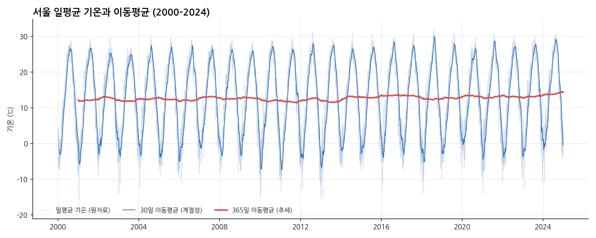
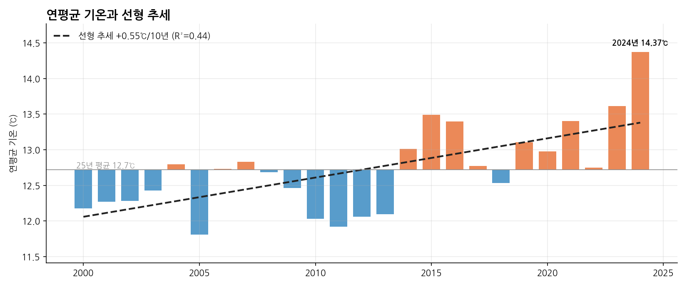
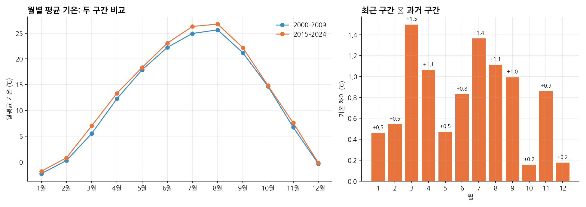
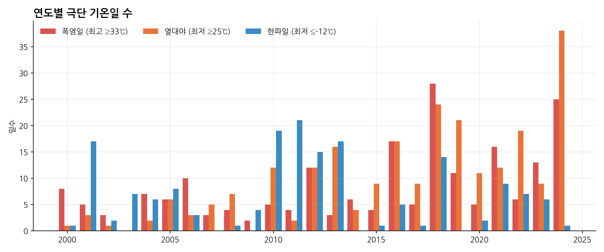
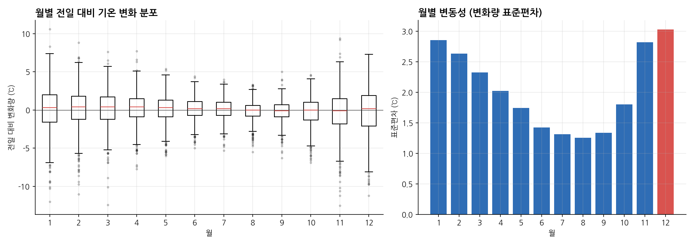
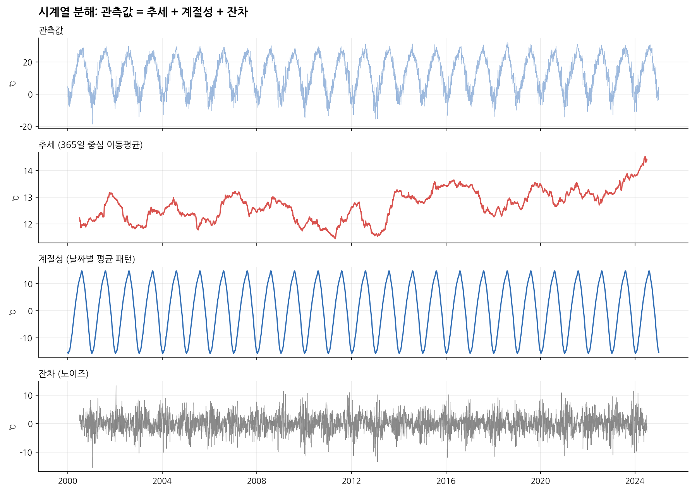
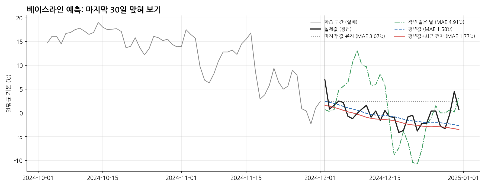

# 서울 25년(2000~2024) 기온 트렌드 분석 리포트

> 이 리포트의 수치와 그래프는 `analysis.py`가 데이터에서 직접 계산해 생성했습니다.
> **먼저 읽어 주세요.** 이 문서는 통계학을 배우지 않은 사람도 이해할 수 있도록, 용어의 뜻과 분석 방법을 선택한 이유를 함께 적은 보고서입니다.
>
> - **관찰(Fact)**: 데이터나 그래프에서 직접 계산해 확인한 수치입니다.
> - **원인 가설(Why)**: 그 수치가 나타난 이유에 대한 *가능한 설명*입니다. 이번 분석만으로 원인을 증명하지 못합니다.
> - **다음 확인(Action)**: 가설이 맞는지 확인하거나 결과를 활용하기 위해 할 일입니다.
>
> 수치·표·그래프는 `analysis.py`가 실제 CSV에서 계산해 다시 만듭니다. 원인 가설과 AI 사용 로그는 제출자가 직접 검토해야 합니다.

## 1. 분석 주제 및 선정 이유 — 왜 서울 기온을 알아볼까요?

**분석 질문은 “서울의 기온이 2000년부터 2024년까지 25년 동안 어떻게 달라졌는가?”입니다.**

“요즘은 여름이 더 덥고 밤에도 잠들기 어렵다”는 이야기를 자주 듣습니다. 하지만 작년에 유난히 더운 날이 있었다는 기억만으로 **25년 동안 실제 기온이 계속 올라갔는지**는 알 수 없습니다. 그래서 날짜별 기온 기록을 모아 숫자로 비교했습니다.

여기서 중요한 말 세 가지를 먼저 알아두면 그래프가 훨씬 쉬워집니다.

| 용어 | 일상적인 뜻 | 왜 구분하나요? |
|---|---|---|
| **추세(Trend)** | 여러 해에 걸쳐 전체적으로 조금씩 올라가거나 내려가는 방향 | 서울이 장기적으로 따뜻해졌는지 보기 위해 |
| **계절성(Seasonality)** | 여름은 덥고 겨울은 추운 것처럼 해마다 반복되는 변화 | 계절 때문에 생기는 큰 변화와 장기 추세를 구분하기 위해 |
| **노이즈(Noise)** | 어느 날 갑자기 춥거나 더워지는 불규칙한 변화 | 날씨가 하루하루 흔들려도 장기 추세를 놓치지 않기 위해 |

**시계열 데이터**는 이렇게 *날짜 순서대로 쌓인 자료*입니다. 같은 수치라도 언제 기록됐는지가 중요합니다. 이 프로젝트는 **Open-Meteo**라는 날씨 데이터 제공 서비스에서 자료를 받아 왔고, **API**(프로그램이 데이터를 자동으로 받아오는 통로)를 이용해 같은 조건의 자료를 다시 가져올 수 있게 했습니다. 다만 이 자료는 서울 한 관측소에서 직접 측정한 실측값이 아니라 **ERA5 재분석 격자 자료**라는 점을 구분해야 합니다.

## 2. 분석 질문 — 무엇을, 왜, 어떻게 확인하나요?

| 질문 | 쉬운 설명 | 분석 방법은 무엇인가요? | 왜 이 방법을 쓰나요? |
|---|---|---|---|
| **Q1. 25년 동안 따뜻해졌을까요?** | 하루가 아니라 여러 해를 보면 서울의 평균 기온이 올라갔는가? | **365일 이동평균**은 앞뒤 약 1년의 값을 평균 내 큰 계절 변화를 완화합니다. **연평균**은 한 해 기온을 하나의 숫자로 요약하고, **선형 추세**는 연도별 점들을 가장 잘 대표하는 직선입니다. | 매일의 폭염·한파만 보면 전체 흐름을 놓치므로, 장기 변화의 방향과 10년당 변화량을 확인하기 위해서입니다. |
| **Q2. 모든 달이 똑같이 변했을까요?** | 1월과 8월, 3월 중 어느 달의 기온 차이가 가장 클까요? | **구간별 월평균 비교**는 2000~2009년과 2015~2024년의 같은 달끼리 평균 기온을 비교하는 것입니다. | 연평균이 올라도 어느 계절이 가장 달라졌는지는 알 수 없기 때문입니다. |
| **Q3. 아주 더운 날과 밤도 늘었을까요?** | 평균 기온 말고 33℃ 이상인 날이나 25℃ 이상인 밤에 가까운 날은 얼마나 늘었을까요? | **기준 초과 일수 집계**는 정해진 기온 기준에 해당하는 날을 해마다 세는 방법입니다. | 평균이 조금 변해도 생활에 불편한 고온일 수는 크게 달라질 수 있기 때문입니다. 이 분석의 '열대야'는 *일 최저기온 기준의 근사치*입니다. |
| **Q4. 어느 달에 기온이 크게 흔들릴까요?** | 어제와 오늘의 기온 차이는 어느 달에 가장 클까요? | **전일 대비 변화량**은 '오늘 평균기온 − 어제 평균기온'이고, **표준편차**는 그 차이가 얼마나 들쭉날쭉한지 보여 주는 숫자입니다. | 같은 평균 기온이어도 어떤 달은 날마다 급변할 수 있기 때문입니다. |

**예를 들어 이동평균은** 어제·오늘·내일의 기온이 10℃, 12℃, 14℃라면 세 날 평균인 12℃로 큰 흐름을 보는 것과 비슷합니다. 실제 분석에서는 30일과 365일을 사용했습니다. **표준편차는** 값이 일정하면 작고 값이 크게 오르내리면 커집니다. 그래서 평균만으로 알 수 없는 '흔들림'을 비교하는 데 쓰입니다.

## 3. 데이터 설명 — 어떤 자료를 사용했나요?

**이 자료는 서울시청 부근의 날씨를 하루에 한 줄씩 정리한 표입니다.** 서울 한 장소에 기온계를 25년 동안 설치해 직접 읽은 자료가 아니라, 관측값과 기상 모델 등을 결합해 과거 날씨를 재구성한 **ERA5 재분석 자료**입니다. 이를 **격자**(지도를 나눈 칸) 형태로 제공하기 때문에 관측소의 실측과는 값이 다를 수 있습니다.

| 항목 | 내용 |
|---|---|
| 출처 | [Open-Meteo Historical Weather API](https://open-meteo.com/en/docs/historical-weather-api) (ECMWF의 ERA5 재분석 자료를 제공하는 서비스) |
| 지점 | 서울시청 부근 (위도 37.5665, 경도 126.9780), 격자 해발고도 34.0 m |
| 기간 | 2000-01-01 ~ 2024-12-31 |
| 데이터 수 | **9,132일** (날짜 하나마다 한 행이며 윤년의 2월 29일도 포함) |
| 사용 모델 | era5 (전 기간을 가능한 한 같은 모델·조건으로 비교하기 위해 선택) |
| 라이선스 | CC BY 4.0 — Weather data by Open-Meteo.com, Generated using Copernicus Climate Change Service information |
| 수집 방법 | `python fetch_data.py` (요청 URL은 `data/metadata.json`에 기록) |

**데이터 열(컬럼)과 빠진 값(결측치) 읽는 법**

**컬럼(Column)**은 표의 세로 항목, **행(Row)**은 날짜별 한 줄입니다. **결측치**는 그 날짜에 기록이 비어 있는 칸을 뜻합니다. 아래의 '결측 수 0'은 *현재 저장된 분석 자료에 비어 있는 값이 없다*는 뜻이지, 모든 기상 데이터에 결측이 없다는 뜻은 아닙니다.

| 열 이름 | 쉬운 뜻 | 단위 | 분석에 쓰는 이유 |
|---|---|---|---|
| `date` | 기온을 기록한 날짜 | 날짜 | 날짜순으로 정렬하고 연·월 단위로 묶으려고 |
| `tmax` | 하루 중 가장 높은 기온 | ℃ | 33℃ 이상인 더운 날을 세려고 |
| `tmin` | 하루 중 가장 낮은 기온 | ℃ | 더운 밤에 가까운 날이나 추운 날을 세려고 |
| `tmean` | 하루 평균 기온 | ℃ | 장기 추세와 하루 사이 변화량을 분석하려고 |
| `precip` | 하루 동안의 강수량 | mm | 기초 자료로 보관했으며, 이번 주요 분석은 기온에 집중함 |

| 컬럼 | 컴퓨터에서 저장한 자료형 | 결측 수 |
|---|---|---|
| `date` | datetime64[ns] | 0 |
| `tmax` | float64 | 0 |
| `tmin` | float64 | 0 |
| `tmean` | float64 | 0 |
| `precip` | float64 | 0 |

**자료형은 무슨 뜻인가요?** `datetime64[us]`는 날짜·시간으로 인식한 값, `float64`는 소수점이 있는 숫자를 저장하는 형식입니다. **`float64`라고 해서 기온을 소수점 아래 64자리까지 측정했다는 뜻은 아닙니다.**

**API 키**는 서비스를 이용할 때 쓰는 인증용 비밀번호와 비슷한 값인데, 이 프로젝트의 데이터 요청은 별도 키 없이 실행하도록 구성되어 있습니다. `fetch_data.py`가 자료를 수집하고 `data/metadata.json`에는 실제 요청 조건을 남깁니다. **재현**이란 다른 사람이 같은 자료·코드·조건으로 계산을 다시 해보고 결과를 비교할 수 있다는 뜻입니다.

### 3-1. 데이터 정제 — 왜 분석 전에 자료를 확인하나요?

**정제(Data Cleaning)**는 표에 중복된 날짜나 비어 있는 값, 서로 모순되는 기온 등이 있는지 확인하고 정리하는 과정입니다. 자료가 틀리면 그래프도 잘못될 수 있어서 계산 전에 검사합니다.

- **중복 날짜:** 하루가 두 번 있으면 평균이 잘못될 수 있어 한 번만 사용합니다.
- **누락 날짜:** 하루가 통째로 빠져 있으면 장기 추세를 계산할 때 문제가 생길 수 있어 날짜를 확인합니다.
- **물리적 범위 점검:** 비정상적으로 큰·작은 값은 입력 오류 가능성이 있어 점검용 범위를 적용합니다. 정한 범위 밖의 모든 날이 자연적으로 불가능하다는 뜻은 아닙니다.
- **논리 오류:** 최저기온이 최고기온보다 큰 경우는 서로 맞지 않는 기록이므로 그대로 사용하지 않습니다.
- **보간(Interpolation):** 며칠 빠진 값을 앞뒤 날짜로 추정해 채우는 것입니다. 실제로 측정된 값이 아니므로 이 프로젝트는 *연속 3일 이하의 짧은 결측*에만 허용합니다.
- **통계적 이상치:** 같은 무렵의 평년 기온과 비교해 특별히 다른 날입니다. **표준편차(σ)**는 값이 보통 얼마나 퍼져 있는지 나타내며, ±4σ는 평소의 흔들림보다 크게 벗어난 날을 표시하는 기준입니다. 실제 폭염·한파가 될 수 있으니 무조건 삭제하지 않습니다.

이 프로젝트에서는 아래 기준으로 검사했고, 결과는 코드가 직접 계산했습니다.

| 단계 | 기준 | 결과 |
|---|---|---|
| 중복 날짜 | 같은 날짜가 2번 이상이면 첫 행만 유지 | 0건 제거 |
| 시간 축 정렬 | 시작~끝 모든 날짜를 만들고 빠진 날짜는 빈 행으로 추가 | 0일 추가 |
| 물리적 이상치 | 기온이 -35~45℃ 밖이거나 강수가 음수면 결측 처리 | tmax 0, tmin 0, tmean 0, precip 0 |
| 논리 오류 | 최저기온 > 최고기온이면 둘 다 결측 처리 | 0건 |
| 결측 보간 | 연속 3일 이하 공백만 선형 보간, 더 긴 공백은 비워 둠 (긴 공백을 채우면 없는 패턴이 생김) | 보간: tmax 0, tmin 0, tmean 0 / 남은 결측: tmax 0, tmin 0, tmean 0 |
| 통계적 이상치 | 같은 날짜의 평년값 대비 ±4σ를 벗어나면 **표시만 하고 유지** (극한 기상은 분석 대상이므로 삭제하지 않음) | 1일 (예: 2002-06-24) |

## 4. 분석 결과 및 시각화

### 4-1. 일평균 기온과 이동평균 — 추세·계절성·노이즈 한눈에 보기 (Q1)



**이 그래프를 왜 그리나요?** 하루 평균기온은 여름과 겨울의 차이가 커서 25년 동안의 작은 변화를 알아보기 어렵습니다. 그래서 **30일 이동평균**(근처 30일씩 묶어 낸 평균)과 **365일 이동평균**(근처 약 1년씩 묶어 낸 평균)을 같이 그려 장기 변화를 더 쉽게 보게 했습니다. 옅은 선이 원래의 매일 기온이고, 평균선이 단기·장기 흐름입니다.

- 원자료(옅은 선)는 하루하루 날씨 때문에 들쭉날쭉하다(**노이즈**).
- **30일 이동평균**은 노이즈를 걷어내 매년 반복되는 여름–겨울 파동(**계절성**)을 보여 준다.
- **365일 이동평균**은 계절성까지 1년 단위로 상쇄해 **장기 추세**만 남긴다. 범위는 11.4~14.5℃이다.
- 집계 단위를 일 → 30일 → 365일로 바꾸면 같은 데이터에서 보이는 패턴이 달라진다. 그래서 질문에 맞춰 창 크기를 골랐다.

### 4-2. 연평균 기온과 선형 추세 (Q1)



**이 그래프를 왜 그리나요?** 하루 기온 대신 한 해의 평균을 하나의 점으로 표시하면 계절 변화가 덜 두드러집니다. **선형 추세**는 그 점들에 가장 잘 들어맞는 직선으로, 한 해의 더위가 아니라 여러 해의 변화 방향을 확인합니다. **10년당 변화량**은 그 직선이 10년 동안 얼마나 올라가거나 내려가는지를 뜻합니다. **95% 범위**는 계산된 추세의 불확실성을 나타내는 *통계적 추정 구간*이며, 미래 기온이 그 안에 95% 들어간다는 뜻은 아닙니다.

- 연평균 기온의 선형 추세는 **+0.55℃/10년**이다. 대략적인 95% 범위 +0.29~+0.81℃로 0을 포함하지 않아, 우연한 흔들림만으로 보기 어렵다.
- 처음 5년(2000~2004) 평균은 12.39℃, 마지막 5년(2020~2024) 평균은 13.42℃로 **+1.03℃** 차이가 난다.
- 가장 더운 해 상위 3개: 2024년(14.37℃), 2023년(13.62℃), 2015년(13.49℃) / 가장 추운 해: 2005년(11.81℃)
- y축은 연평균 범위에 맞췄다. 0℃부터 그리면 1℃ 안팎의 변화가 평평하게 보여 추세를 읽을 수 없기 때문이다.

### 4-3. 월별 평균 기온: 과거 vs 최근 (Q2)



**이 그래프를 왜 그리나요?** 25년 동안 연평균만 보면 겨울과 봄 중 어디에서 기온이 더 크게 달라졌는지 알 수 없습니다. **구간별 통계**는 전체 기간 중 두 구간을 정해 같은 달끼리 평균을 비교하는 방법입니다. 예를 들어 두 기간의 3월 평균을 비교해 '3월이 얼마나 달라졌나'를 확인합니다. 이는 변화가 계속 일정하게 일어났다는 증거는 아닙니다.

- 12개월 중 **12개월**은 최근 구간(2015~2024)이 과거 구간(2000~2009)보다 따뜻하다.
- 가장 많이 오른 달: **3월 (+1.50℃)** / 가장 적게 오르거나 내린 달: **10월 (+0.16℃)**
- 두 구간 사이에 5년 간격(2010~2014)을 둔 것은 경계 부근의 해가 결과를 좌우하지 않게 하기 위해서다.

### 4-4. 연도별 극단 기온일 수 (Q3)



**이 그래프를 왜 그리나요?** 평균이 1℃ 정도 달라져도 생활에서 체감하는 아주 더운 날이나 밤의 **횟수**는 크게 바뀔 수 있습니다. 따라서 미리 정한 기준을 넘는 날을 해마다 직접 셉니다. 이 분석에서 **폭염일**은 최고기온 33℃ 이상, **열대야 근사일**은 그 날짜의 최저기온 25℃ 이상, **한파일**은 최저기온 -12℃ 이하인 날로 계산했습니다. *기상청 공식 열대야 정의는 야간 시간대를 기준으로 하므로, 여기의 일 최저기온 기준과 같지 않습니다.* 아래의 '연평균'은 각 기간에 해마다 해당하는 날이 평균 몇 일인지 뜻합니다.

| 지표 | 2000~2009 연평균 | 2015~2024 연평균 | 변화 | 최다 연도 |
|---|---|---|---|---|
| 폭염일 (최고 ≥33℃) | 4.8일 | 13.0일 | 2.7배 | 2018년 (28일) |
| 열대야 (최저 ≥25℃) | 2.8일 | 16.9일 | 6.0배 | 2024년 (38일) |
| 한파일 (최저 ≤-12℃) | 4.9일 | 4.6일 | 0.9배 | 2011년 (21일) |

### 4-5. 하루 사이 기온 변동성 (Q4)



**이 그래프를 왜 그리나요?** 같은 10℃라도 날마다 9℃·11℃를 오가는 경우와 2℃·18℃를 오가는 경우는 매우 다릅니다. 그래서 **전일 대비 변화량**(오늘의 평균기온에서 어제의 평균기온을 뺀 수치)을 먼저 구한 뒤, 그 차이들이 얼마나 퍼져 있는지 **표준편차**로 비교했습니다. 표준편차가 큰 달은 하루 사이 기온 변화 폭이 들쭉날쭉한 경향이 강한 달입니다.

- 기온은 0℃ 근처에서 부호가 바뀌어 **%변화율이 의미가 없다**(예: 0.5℃ → 1℃는 +100%). 그래서 **전일 대비 변화량(℃)**을 변화 지표로 썼다.
- 변동성(변화량 표준편차)이 가장 큰 달은 **12월(3.03℃)**, 가장 작은 달은 **8월(1.26℃)**이다.
- 하루 만에 가장 크게 떨어진 기록은 -12.5℃(11월), 가장 크게 오른 기록은 +10.6℃(1월)이다.

### 4-6. (보너스) 시계열 분해 — 추세 / 계절성 / 잔차



#### ① 시계열 분해란 무엇인가요?

**시계열(Time Series)**이란 시간 순서대로 기록한 데이터를 말합니다.

예를 들어 매일 기록한 서울의 기온, 매월 기록한 상품 판매량, 매년 조사한 인구수 등이 시계열 데이터입니다.

서울의 기온을 2000년부터 2024년까지 그래프로 그리면 오르락내리락하는 선이 나타납니다.

그런데 기온이 변하는 이유를 살펴보면 서로 다른 변화가 겹쳐 있습니다.

- **장기적인 변화:** 여러 해에 걸쳐 서울의 평균적인 기온 수준이 달라지는 현상
- **계절에 따른 변화:** 여름에는 덥고 겨울에는 추운 현상이 매년 반복되는 것
- **불규칙한 변화:** 같은 여름이라도 어떤 날은 유난히 덥고, 어떤 날은 비가 내려 서늘한 것

이 세 가지가 하나의 그래프에 섞여 있으면 장기적인 변화가 잘 보이지 않습니다.

**시계열 분해(Time Series Decomposition)**는 이렇게 여러 변화가 섞인 데이터를 나누어 각각의 특징을 살펴보는 분석 방법입니다.

#### ② 시계열 분해를 왜 하나요?

이 과제의 핵심 질문 중 하나는 **"지난 25년 동안 서울의 기온이 상승했는가?"**입니다.

하지만 기온은 여름과 겨울의 차이가 매우 큽니다.

예를 들어 어느 해 1월의 기온이 영하이고 8월의 기온이 30℃에 가까워도, 그것만으로 서울의 기온이 장기적으로 상승했다고 판단할 수는 없습니다.

단순한 계절 변화일 수도 있기 때문입니다.

그래서 다음 세 가지를 구분합니다.

1. 매년 반복되는 여름과 겨울의 영향을 구분합니다.
2. 하루하루 불규칙하게 나타나는 기온 변화도 구분합니다.
3. 이러한 변화 속에서 여러 해에 걸쳐 기온이 어떻게 달라지는지 확인합니다.

**즉, 계절에 따라 반복되는 변화와 장기적인 기온 변화를 혼동하지 않기 위해 시계열 분해를 사용합니다.**

---

#### ③ 시계열 분해의 세 가지 구성 요소

**1. 추세(Trend) — 장기적으로 기온이 어떻게 변했을까요?**

추세란 데이터가 오랜 기간에 걸쳐 전체적으로 증가하거나 감소하는 흐름을 말합니다.

예를 들어 최근 며칠 동안 기온이 올라갔다고 해서 서울이 장기적으로 더워졌다고 판단할 수는 없습니다.

하지만 여러 해의 기온을 비교했을 때 평균적인 수준이 계속 높아진다면 장기적인 상승 추세가 있다고 해석할 수 있습니다.

이번 과제에서는 **365일 중심 이동평균**을 이용해 장기적인 흐름을 추정했습니다.

- **이동평균(Moving Average):** 일정한 개수의 데이터를 묶어 평균을 구하고, 계산 구간을 조금씩 옮기면서 평균을 계속 구하는 방법입니다.
- **365일:** 약 1년의 데이터를 함께 살펴본다는 의미입니다.
- **중심 이동평균(Centered Moving Average):** 특정 날짜를 중심으로 앞뒤의 관측값을 이용해 평균을 계산하는 방법입니다.

**왜 365일을 사용할까요?**

서울은 1년을 주기로 봄·여름·가을·겨울이 반복됩니다. 약 1년 동안의 기온을 묶어 평균을 계산하면 특정 계절이나 특정 날짜의 영향이 완화되어 장기적인 흐름을 살펴보기 쉬워집니다.

다만 이동평균으로 계산한 추세는 장기적인 변화를 부드럽게 표현한 추정값이지, 기후 변화의 원인을 직접 증명하는 값은 아닙니다.

**2. 계절성(Seasonality) — 매년 반복되는 변화는 무엇일까요?**

계절성이란 일정한 시간 간격으로 비슷한 변화가 반복되는 현상을 말합니다.

서울의 기온을 생각하면 쉽게 이해할 수 있습니다.

- 여름에는 대체로 기온이 높습니다.
- 겨울에는 대체로 기온이 낮습니다.
- 이러한 현상이 매년 비슷한 시기에 반복됩니다.

이번 분석에서는 **날짜별 평균 패턴**을 이용해 매년 반복되는 기온 변화를 추정했습니다.

예를 들어 여러 해의 7월 중순 기온과 1월 중순 기온을 각각 살펴보면, 일반적으로 어느 시기가 더 덥고 추운지 확인할 수 있습니다.

이처럼 매년 비슷한 시기에 되풀이되는 부분을 구분하는 것이 계절성 분석입니다.

**왜 계절성을 따로 구분할까요?**

서울의 기온이 1월보다 8월에 높다는 사실은 장기적인 기온 상승을 뜻하지 않습니다. 매년 반복되는 계절적 차이이기 때문입니다.

계절성을 따로 구분하면 이러한 반복적인 변화와 장기 추세를 혼동하지 않을 수 있습니다.

**3. 잔차(Residual) — 추세와 계절성으로 설명되지 않는 변화는 무엇일까요?**

잔차란 실제 관측값에서 추세와 계절성으로 설명되는 부분을 제외하고 남은 값을 말합니다.

예를 들어 여름에는 원래 기온이 높지만, 같은 여름이라도 평소보다 유난히 더운 날이나 서늘한 날이 있습니다.

이러한 불규칙한 변화의 일부가 잔차에 나타납니다.

잔차에는 다음과 같은 요소가 포함될 수 있습니다.

- 평소와 다른 일시적인 날씨 변화
- 폭염이나 갑작스러운 기온 하락
- 추세와 계절성으로 충분히 설명되지 않는 변화
- 자료나 분석 방법에서 비롯된 차이

**잔차는 잘못 측정한 값이나 분석 오류만을 의미하지 않습니다.**

실제 날씨에 나타나는 불규칙한 변화도 포함합니다.

**왜 잔차를 확인할까요?**

추세와 계절성을 구분한 뒤에도 얼마나 큰 변화가 남아 있는지 확인하기 위해서입니다. 잔차가 크게 나타나는 날짜는 평소와 다른 날씨 현상이 있었는지 추가로 살펴볼 수 있습니다.

다만 잔차가 크다는 사실만으로 그 원인을 폭염이나 특정 기상 현상이라고 확정할 수는 없습니다.

---

#### ④ 가법 분해(Additive Decomposition)란 무엇인가요?

이번 과제에서는 **고전적 가법 분해**라는 방법을 사용했습니다.

'가법'은 여러 값을 더한다는 뜻입니다.

실제 관측한 기온을 다음 세 부분의 합으로 나타냅니다.

**관측값 = 추세 + 계절성 + 잔차**

여기서 각 항목은 다음과 같습니다.

| 용어 | 쉬운 의미 |
|---|---|
| 관측값(Observed) | 실제 데이터에 기록된 기온 |
| 추세(Trend) | 장기적으로 변하는 기온 수준 |
| 계절성(Seasonality) | 매년 비슷한 시기에 반복되는 기온 변화 |
| 잔차(Residual) | 추세와 계절성을 제외하고 남은 변화 |

**이해를 돕기 위한 가상의 예시**

어느 날 실제 평균기온이 20℃이고, 분석 결과 각 요소가 다음과 같이 계산되었다고 가정하겠습니다.

- 추세: 15℃
- 계절성: +4℃
- 잔차: +1℃

이 세 값을 더하면 다음과 같습니다.

15℃ + 4℃ + 1℃ = **20℃**

즉, 실제 기온을 장기적인 기온 수준, 계절에 따른 영향, 나머지 변화로 나누어 표현할 수 있다는 뜻입니다.

*위 숫자는 계산 원리를 설명하기 위한 가상의 예시이며, 이번 서울 기온 데이터에서 실제로 계산된 특정 날짜의 결과는 아닙니다.*

---

#### ⑤ 시계열 분해 그래프는 어떻게 읽어야 하나요?

이번 그래프에서는 원래 기온을 여러 요소로 나누어 살펴봅니다.

| 그래프 | 무엇을 보여주나요? | 무엇을 확인하면 되나요? |
|---|---|---|
| 관측값 | 실제 서울의 일별 기온 | 여름과 겨울에 기온 차이가 크게 나타나는지 |
| 추세 | 365일 이동평균으로 계산한 장기적인 흐름 | 여러 해에 걸쳐 평균적인 기온 수준이 어떻게 달라지는지 |
| 계절성 | 매년 반복되는 기온 변화 | 여름과 겨울에 반복되는 패턴이 얼마나 뚜렷한지 |
| 잔차 | 추세와 계절성을 제외한 나머지 변화 | 불규칙하게 나타나는 기온 변화가 얼마나 큰지 |

**중요한 점은 네 그래프를 각각 따로 읽는 것이 아니라 서로 비교해서 읽어야 한다는 것입니다.**

관측값 그래프에서 큰 폭의 기온 변화가 나타나더라도, 그 변화의 상당 부분이 계절성에서 반복적으로 나타난다면 이를 모두 장기적인 기온 상승으로 해석해서는 안 됩니다.

---

#### ⑥ 실제 분석 결과는 무엇인가요?

이번 서울 기온 데이터의 시계열 분해 결과는 다음과 같습니다.

| 분석 결과 | 실제 계산값 | 쉬운 설명 |
|---|---:|---|
| 계절성 진폭 | 약 30.3℃ | 계절성의 가장 높은 값과 가장 낮은 값의 차이 |
| 추세 변동 범위 | 약 3.1℃ | 분석 기간 동안 추세의 가장 높은 값과 가장 낮은 값의 차이 |
| 잔차 표준편차 | 약 2.9℃ | 추세와 계절성을 제외한 값들이 얼마나 흩어져 있는지 나타내는 수치 |

**첫째, 계절성 진폭은 약 30.3℃입니다.**

진폭은 가장 높은 값에서 가장 낮은 값을 뺀 차이를 말합니다.

이번 분석에서 계절성 진폭이 약 30.3℃라는 것은 매년 반복되는 기온 패턴의 높은 부분과 낮은 부분 사이에 약 30.3℃의 차이가 있다는 의미입니다.

즉, 서울은 여름과 겨울의 기온 차이가 매우 뚜렷하다는 사실을 보여줍니다.

다만 이것이 실제 특정 날짜의 최고기온과 최저기온의 차이가 30.3℃라는 뜻은 아닙니다. 분석을 통해 추정한 **계절성 요소의 차이**입니다.

**둘째, 추세 변동 범위는 약 3.1℃입니다.**

이 값은 25년의 분석 기간에 추정된 장기 추세 중 가장 높은 값과 가장 낮은 값의 차이입니다.

계절성 진폭 30.3℃와 비교하면 훨씬 작습니다.

따라서 일별 기온 그래프에서는 계절에 따른 큰 변화 때문에 장기적인 흐름이 상대적으로 잘 보이지 않을 수 있습니다.

여기서 주의할 점은 **추세 변동 범위 3.1℃가 2000년부터 2024년까지 기온이 정확히 3.1℃ 상승했다는 뜻은 아니라는 것**입니다.

분석 기간의 추세 최고점과 최저점 사이의 차이이므로, 시작 시점과 종료 시점의 변화량이나 선형 추세의 상승률과는 구분해야 합니다.

**셋째, 잔차 표준편차는 약 2.9℃입니다.**

표준편차(Standard Deviation)는 여러 숫자가 평균을 중심으로 얼마나 넓게 흩어져 있는지 나타내는 통계값입니다.

- 표준편차가 작으면 값이 비교적 일정한 범위에 모여 있습니다.
- 표준편차가 크면 값이 상대적으로 크게 흩어져 있습니다.

이번 분석에서 잔차 표준편차가 약 2.9℃라는 것은 장기 추세와 계절성을 제외한 뒤에도 일별 기온에 불규칙한 변동이 남아 있다는 의미입니다.

다만 매일 정확히 2.9℃씩 달라진다는 뜻은 아닙니다. 잔차가 얼마나 넓게 흩어져 있는지를 나타내는 수치입니다.

---

#### ⑦ 이 분석을 통해 무엇을 알 수 있나요?

**관찰(Fact) — 실제 계산된 사실**

1. 매년 반복되는 계절성의 진폭은 약 30.3℃입니다.
2. 분석 기간의 장기 추세 변동 범위는 약 3.1℃입니다.
3. 추세와 계절성을 제외한 잔차의 표준편차는 약 2.9℃입니다.

**해석(Why) — 이러한 결과를 어떻게 이해할 수 있을까요?**

서울의 일별 기온은 계절에 따른 반복적인 변화가 매우 크게 나타납니다.

장기 추세의 변동 폭은 계절성 진폭보다 작기 때문에, 일별 기온 그래프만 보고 여러 해에 걸친 기온 변화를 판단하기는 어렵습니다.

따라서 일별 기온에서 계절성을 분리하거나, 4-2절처럼 연 단위로 평균을 계산하여 장기적인 흐름을 함께 살펴보는 것이 좋습니다.

단, 계절성 진폭이 크다는 사실이 기온 상승의 원인을 설명하거나 장기적인 기후 변화가 중요하지 않다는 뜻은 아닙니다.

**후속 분석(Action) — 다음에는 무엇을 확인하면 좋을까요?**

1. 연평균 기온의 선형 추세와 분해된 추세를 비교합니다.
2. 여름과 겨울을 구분해 계절별 기온 변화가 서로 다른지 확인합니다.
3. 잔차가 크게 나타난 날짜를 실제 폭염·한파 등 기상 기록과 비교합니다.
4. 분석 기간이나 이동평균의 계산 기간을 변경해도 비슷한 결과가 나타나는지 확인합니다.

---

#### ⑧ 이번 분석의 한계는 무엇인가요?

시계열 분해는 데이터에 나타난 변화의 특징을 이해하도록 도와주지만, **기온이 왜 변했는지를 직접 증명하는 방법은 아닙니다.**

특히 다음 사항에 주의해야 합니다.

- 365일 이동평균으로 계산한 추세는 분석 방법에 따른 추정값입니다.
- 고전적 분해에서 계산한 계절성은 기본적으로 분석 기간에 반복되는 평균적인 계절 패턴을 나타내므로, 매년 계절의 특징이 달라지는 현상을 모두 설명하지는 못합니다.
- 잔차에는 실제 날씨 변화뿐 아니라 분석 방법으로 충분히 설명하지 못한 부분도 포함됩니다.
- 이 분석만으로 도시화, 온실가스, 기후변화 등 특정 요인이 기온 변화에 얼마나 영향을 주었는지 확정할 수 없습니다.

따라서 시계열 분해 결과는 연평균 기온, 월별 변화, 폭염일·열대야 일수 등 다른 분석 결과와 함께 해석해야 합니다.

#### ⑨ 동료평가에서는 이 분석을 어떻게 평가할 수 있나요?

이번 보너스 과제에서 주목할 부분은 단순히 새로운 그래프를 하나 더 만들었다는 점이 아닙니다.

**서울의 기온은 계절 변화가 매우 크기 때문에, 일별 데이터에서 장기적인 변화만을 찾아내기 어렵다는 문제를 이해하고 시계열 분해라는 분석 방법을 적용했다는 점**입니다.

분해 결과를 통해 장기적인 추세, 매년 반복되는 계절성, 불규칙한 변화를 구분하고, 계절성 진폭 약 30.3℃, 추세 변동 범위 약 3.1℃, 잔차 표준편차 약 2.9℃라는 수치를 근거로 설명했습니다.

또한 분해 결과만으로 기온 변화의 원인을 단정하지 않고, 연평균 기온과 계절별 변화 등 추가 분석의 필요성을 제시할 수 있다는 점에서 분석 방법을 적절하게 활용했다고 평가할 수 있습니다.

**결론적으로, 시계열 분해 보너스는 기온이 변했다는 사실을 보여주는 데서 그치지 않고, 서로 다른 종류의 변화를 나누어 이해하려는 분석이라는 점에서 학습 가치가 있습니다.**

### 4-7. (보너스 2-B) 간단 예측 — 베이스라인으로 마지막 30일의 기온 예측하기



#### ① 이번 분석에서는 무엇을 알아보려고 하나요?

이번 분석의 목적은 **과거의 기온 자료만 사용해 앞으로의 기온을 얼마나 정확하게 예상할 수 있는지 확인하는 것**입니다.

우리는 일기예보를 통해 내일의 기온을 미리 확인합니다. 하지만 기온을 예상할 때 반드시 복잡한 인공지능(AI) 모델부터 사용해야 하는 것은 아닙니다.

예를 들어 다음과 같은 방법으로도 기온을 예상할 수 있습니다.

- 작년 같은 날짜의 기온을 참고하기
- 과거 여러 해의 같은 날짜 평균기온을 참고하기
- 마지막으로 확인한 날의 기온이 앞으로도 유지된다고 가정하기

이러한 간단한 방법이 실제로 얼마나 잘 맞는지 먼저 확인하는 것이 이번 분석의 목적입니다.

#### ② 베이스라인(Baseline)이란 무엇인가요?

**베이스라인은 다른 방법과 성능을 비교하기 위해 사용하는 기본적인 기준 방법**입니다.

예를 들어 새로운 AI 기온 예측 프로그램을 만들었다고 가정하겠습니다.

이 프로그램이 기온을 평균 2℃ 정도 틀리게 예측했다면 잘 만든 프로그램일까요?

그것만으로는 판단하기 어렵습니다.

과거 같은 날짜의 평균기온만 사용해도 평균 1.5℃ 정도의 오차로 예측할 수 있다면, 새 AI 프로그램이 오히려 덜 정확한 것입니다.

그래서 복잡한 분석이나 AI 모델을 사용하기 전에 간단한 방법의 성능부터 확인합니다.

**베이스라인을 사용하는 이유는 복잡한 모델을 만들 필요가 있는지 판단할 비교 기준을 마련하기 위해서입니다.**

이번 과제에서는 네 가지 간단한 예측 방법을 비교했습니다.

---

#### ③ 예측은 어떤 방식으로 진행했나요?

이번 분석에서는 서울의 2000년 1월 1일부터 2024년 12월 31일까지의 기온 자료를 사용했습니다.

하지만 예측 성능을 평가할 때는 모든 날짜의 기온을 미리 알고 있으면 안 됩니다.

미래의 실제 기온을 알고 예측한다면 공정한 비교가 되지 않기 때문입니다.

그래서 다음과 같이 기간을 구분했습니다.

| 구분 | 기간 | 목적 |
|---|---|---|
| 과거 자료(학습 구간) | 2000-01-01 ~ 2024-12-01 | 기온을 예측할 때 참고하는 데이터 |
| 예측 대상(평가 구간) | 2024-12-02 ~ 2024-12-31 | 예측값과 실제 기온을 비교하는 30일 |

쉽게 말해 **2024년 12월 1일에 서 있다고 가정하고, 그다음 30일 동안의 기온을 미리 맞혀 보는 실험**입니다.

이미 지나간 날짜이지만, 과거 자료를 이용해 당시에는 알 수 없었던 미래를 예측하는 상황을 재현한 것입니다.

이때 실제로 예측한 것은 일별 평균기온입니다.

#### ④ 네 가지 예측 방법은 무엇이며, 왜 비교하나요?

**방법 1. 평년값(Climatology) — 예전 같은 날짜의 평균기온을 참고하기**

평년값이란 과거 여러 해의 같은 시기에 관측된 기온을 바탕으로 계산한 일반적인 기온 수준입니다.

예를 들어 12월 10일의 기온을 예측할 때, 과거 여러 해의 12월 10일 무렵 기온을 참고해 평균적인 값을 구합니다.

이번 코드에서는 과거 날짜별 평균기온을 계산하고, 인접한 날짜의 값을 이용해 변화를 부드럽게 만드는 방법도 사용했습니다.

**왜 사용하나요?**

서울은 겨울에 춥고 여름에 덥다는 계절적 특징이 뚜렷합니다.

따라서 특정 날짜의 기온을 정확하게 몰라도 과거 같은 시기의 평균적인 기온을 참고하면 기본적인 예측이 가능합니다.

다만 여기서 말하는 평년값은 이번 프로젝트에서 계산한 과거 날짜별 평균값으로, 기상기관이 공식적으로 발표하는 30년 기후평년값과 반드시 같은 것은 아닙니다.

**방법 2. 평년값 + 최근 7일 편차 — 최근 날씨까지 반영하기**

먼저 과거 자료를 이용해 평년값을 계산합니다.

그다음 최근 7일 동안 실제 기온이 평년보다 얼마나 따뜻하거나 추웠는지 확인합니다.

예를 들어 최근 일주일의 평균기온이 평년보다 2℃ 높았다면 앞으로도 그 영향이 이어질 수 있다고 가정해 평년값을 보정합니다.

**왜 사용하나요?**

과거의 계절적 특징뿐 아니라 최근 날씨의 흐름도 반영하면 예측이 개선될 수 있는지 알아보기 위해서입니다.

다만 최근의 따뜻하거나 추운 상태가 앞으로 30일 동안 계속된다는 보장은 없습니다.

**방법 3. 마지막 값 유지(Naive Forecast) — 현재 기온이 그대로 이어진다고 가정하기**

마지막으로 확인한 날의 기온을 앞으로의 예측값으로 사용하는 방법입니다.

이번 실험에서는 2024년 12월 1일의 평균기온을 이후 30일의 예측값으로 사용했습니다.

**왜 사용하나요?**

가장 간단한 예측 방법이기 때문입니다.

별도의 복잡한 계산 없이도 기준 예측값을 만들 수 있어, 다른 방법이 이보다 얼마나 개선되었는지 비교할 수 있습니다.

하지만 12월은 겨울이 진행되면서 기온이 달라질 수 있으므로, 한 날짜의 기온을 30일 내내 유지한다고 가정하는 것은 한계가 있습니다.

**방법 4. 작년 같은 날(Seasonal Naive) — 1년 전 날짜의 기온을 참고하기**

예를 들어 2024년 12월 10일의 기온을 예측할 때 2023년 12월 10일의 실제 기온을 사용하는 방법입니다.

**왜 사용하나요?**

기온에는 1년을 주기로 반복되는 계절적 특징이 있으므로, 1년 전 같은 날짜의 기온이 현재의 기온을 예측하는 데 얼마나 도움이 되는지 확인하기 위해서입니다.

다만 같은 날짜라도 해마다 기온이 같지는 않습니다. 작년에 유난히 따뜻하거나 추웠다면 예측 오차가 커질 수 있습니다.

---

#### ⑤ 예측이 얼마나 정확한지는 어떻게 확인하나요?

이번 과제에서는 **MAE(Mean Absolute Error, 평균절대오차)**라는 방법을 사용했습니다.

평균절대오차란 **예측한 기온과 실제 기온이 평균적으로 얼마나 차이 났는지 계산한 값**입니다.

예를 들어 다음과 같이 예측했다고 가정해 보겠습니다.

| 날짜 | 실제 기온 | 예측 기온 | 차이의 크기 |
|---|---:|---:|---:|
| 첫째 날 | 5℃ | 6℃ | 1℃ |
| 둘째 날 | 7℃ | 5℃ | 2℃ |
| 셋째 날 | 4℃ | 5℃ | 1℃ |

오차의 크기를 모두 더하면 4℃입니다.

이를 3일로 나누면 평균절대오차는 약 **1.33℃**입니다.

여기서 중요한 점은 실제보다 높게 예측했는지 낮게 예측했는지와 관계없이, 차이의 크기를 계산한다는 것입니다.

**평균절대오차는 숫자가 작을수록 예측이 실제 기온에 더 가까웠다는 뜻입니다.**

*위 표는 계산 방법을 설명하기 위한 가상 예시입니다.*

---

#### ⑥ 실제 예측 결과는 어떻게 나왔나요?

2024년 12월 2일부터 12월 31일까지 30일의 평균기온을 예측하고, 실제 기온과 비교한 결과입니다.

| 예측 방법 | MAE (평균절대오차) | 결과 해석 |
|---|---:|---|
| **평년값** | **1.58℃** | 네 가지 중 실제 기온에 가장 가까움 |
| 평년값 + 최근 7일 편차 | 1.77℃ | 최근 날씨를 반영했지만 오차가 조금 더 큼 |
| 마지막 값 유지 | 3.07℃ | 한 날짜의 기온을 계속 사용해 오차가 비교적 큼 |
| 작년 같은 날 | 4.91℃ | 이번 실험에서는 오차가 가장 큼 |

**첫째, 평년값의 평균절대오차는 약 1.58℃였습니다.**

이는 예측한 30일 동안 실제 기온과 예측 기온 사이의 차이가 평균적으로 약 1.58℃였다는 뜻입니다.

다만 매일 정확히 1.58℃씩 틀렸다는 뜻은 아닙니다. 어떤 날은 실제 기온과 거의 같았고, 어떤 날은 더 크게 차이 났을 수 있습니다.

이번 비교에서는 평년값을 활용한 방법이 가장 좋은 결과를 보였습니다.

**둘째, 평년값에 최근 7일의 기온 편차를 더한 방법은 약 1.77℃의 오차를 보였습니다.**

최근 날씨의 특징까지 추가했다고 해서 반드시 예측이 더 정확해지는 것은 아니라는 점을 확인할 수 있습니다.

이번 코드에서는 최근 7일의 기온이 평년보다 평균 약 0.83℃ 낮았던 영향을 반영했지만, 이 보정이 오차를 줄이지는 못했습니다.

이것은 최근 날씨의 영향이 30일 동안 같은 정도로 유지되지 않았을 가능성 등을 추가로 검토할 필요가 있음을 보여줍니다.

**셋째, 마지막 값 유지 방법의 오차는 약 3.07℃였습니다.**

12월 1일의 기온을 이후 30일 동안 계속 사용했기 때문에, 기온이 변하는 상황에 충분히 대응하기 어려웠다고 해석할 수 있습니다.

**넷째, 작년 같은 날 방법의 오차는 약 4.91℃였습니다.**

1년 전 같은 날짜를 참고하는 방법은 간단하지만, 해당 날짜의 날씨가 해마다 같지 않기 때문에 오차가 크게 발생할 수 있습니다.

이번 실험에서는 네 가지 방법 가운데 가장 큰 오차를 보였습니다.

---

#### ⑦ 이번 실험에서 무엇을 알 수 있나요?

**관찰(Fact) — 실제 계산 결과**

1. 네 가지 방법 중 평년값을 사용한 방법의 오차가 가장 작았습니다.
2. 평년값에 최근 7일의 편차를 더해도 이번 실험에서는 예측이 개선되지 않았습니다.
3. 마지막 값 유지와 작년 같은 날 방법은 상대적으로 큰 오차를 보였습니다.

**해석(Why) — 왜 이런 차이가 나타났을까요?**

서울의 기온은 계절적인 특징이 뚜렷합니다.

따라서 12월에는 대체로 어느 정도의 기온이 나타나는지 과거 여러 해의 자료를 참고하는 방법이 유용할 수 있습니다.

반면 특정 날짜의 기온이나 최근 일주일의 기온이 앞으로 30일 동안 계속 비슷하게 유지된다고 가정하면 실제 날씨 변화에 대응하기 어렵습니다.

다만 이러한 설명은 가능한 해석이며, 이번 한 번의 결과만으로 모든 겨울이나 다른 계절에서도 평년값이 가장 정확하다고 결론 내릴 수는 없습니다.

**후속 분석(Action) — 다음에는 무엇을 확인하면 좋을까요?**

1. 12월뿐 아니라 봄·여름·가을에도 같은 방법으로 예측해 비교합니다.
2. 여러 해의 서로 다른 30일 구간을 대상으로 반복해서 실험합니다.
3. 예측 기간을 7일·14일·30일로 나누어 오차가 어떻게 달라지는지 확인합니다.
4. 필요하다면 기온뿐 아니라 강수량이나 다른 기상 자료를 활용하는 방법과 비교합니다.

---

#### ⑧ 이번 분석의 한계는 무엇인가요?

이번 실험은 네 가지 간단한 예측 방법을 비교했다는 점에서 의미가 있지만 다음과 같은 한계가 있습니다.

**첫째, 예측한 기간이 30일 한 번뿐입니다.**

이번 결과만으로 어느 예측 방법이 언제나 가장 좋다고 단정할 수 없습니다.

**둘째, 12월이라는 특정 계절만 평가했습니다.**

겨울이 아닌 다른 계절에서는 결과가 달라질 수 있습니다.

**셋째, 실제 미래의 날씨를 예측한 것은 아닙니다.**

이미 관측된 과거 자료의 마지막 30일을 숨겨 놓고, 그 기간을 모르는 상황이라고 가정해 수행한 사후 예측 실험입니다.

**넷째, 기온을 변화시키는 다양한 요인을 직접 분석하지 않았습니다.**

네 가지 방법은 과거 기온의 특징을 이용한 간단한 예측이므로 실제 기상예보 시스템과 같은 수준의 정보를 활용하지 않습니다.

따라서 이번 실험은 기상예보 서비스의 성능을 증명하기보다, 간단한 예측 방법들을 비교하고 성능을 평가하는 방법을 학습하는 데 목적이 있습니다.

---

#### ⑨ 동료평가에서는 이 분석을 어떻게 평가할 수 있나요?

이번 분석에서 긍정적으로 평가할 부분은 **단순히 미래 기온을 예측했다는 것이 아니라, 서로 다른 예측 방법을 같은 조건에서 비교하고 실제 오차를 계산했다는 점**입니다.

특히 다음과 같은 학습 성과가 있습니다.

- 과거 자료와 평가할 날짜를 구분해 예측 실험을 구성했습니다.
- 복잡한 AI 모델을 사용하기 전에 간단한 기준 예측 방법을 비교했습니다.
- 네 가지 방법을 동일한 30일 구간에 적용했습니다.
- 평균절대오차(MAE)를 이용해 어떤 방법의 예측이 실제 기온에 더 가까웠는지 수치로 확인했습니다.
- 최근 기온을 추가로 반영한다고 반드시 성능이 좋아지는 것은 아니라는 사실을 확인했습니다.
- 한 번의 실험만으로 예측 방법의 우수성을 일반화할 수 없다는 한계도 설명했습니다.

**결론적으로, 이번 베이스라인 예측은 과거 자료를 이용한 예측 방법을 이해하고, 예측 결과를 실제 데이터와 비교해 검증하는 과정을 경험했다는 점에서 의미 있는 보너스 분석입니다.**

이번 과제의 공식 보너스 2인 **「시계열 심화 옵션 (분해/예측)」 중 (B) 간단 예측에 해당합니다.**

## 5. 인사이트 — 숫자에서 어떤 의미를 읽을 수 있나요?

### 5-1. 인사이트란 무엇인가요?

**인사이트(Insight)**란 데이터를 분석한 뒤, 숫자나 그래프에서 발견한 사실이 무엇을 의미하는지 생각하고 앞으로 어떻게 활용할 수 있을지 정리한 내용입니다.

예를 들어 서울의 평균기온이 10년 동안 0.5℃ 올랐다는 결과가 나왔다고 가정해 보겠습니다.

단순히 "기온이 0.5℃ 올랐다"고 설명하는 것은 분석 결과를 전달한 것입니다.

하지만 다음과 같은 질문까지 생각하면 더 의미 있는 분석이 됩니다.

- 서울의 기온이 장기적으로 계속 상승하고 있을까?
- 봄·여름·가을·겨울 중 어느 계절에서 변화가 클까?
- 평균기온이 상승하면 폭염이나 열대야도 늘어날까?
- 이러한 변화에 대비하려면 어떤 자료를 추가로 확인해야 할까?

이렇게 **데이터에서 확인한 결과를 해석하고, 다음에 무엇을 할지 생각하는 과정**을 인사이트 도출이라고 합니다.

이번 과제에서는 인사이트를 세 단계로 구분했습니다.

| 구분 | 쉬운 의미 | 예시 |
|---|---|---|
| 관찰(Fact) | 데이터와 계산으로 직접 확인할 수 있는 사실 | 서울의 연평균 기온 선형 추세는 10년당 약 +0.55℃ |
| 원인 가설(Why) | 왜 그런 현상이 나타났는지 설명하는 가능한 이유 | 지구온난화나 도시화 등이 영향을 주었을 가능성 |
| 행동(Action) | 해석을 확인하거나 결과를 활용하기 위해 다음에 할 일 | 기상청 관측소 자료와 비교하기 |

**중요한 점은 관찰과 원인 가설을 혼동하지 않는 것입니다.**

예를 들어 서울의 기온이 상승했다는 사실을 확인하더라도, 그것만으로 특정 원인이 기온을 몇 ℃ 상승시켰는지 알 수는 없습니다.

따라서 이번 보고서에서는 데이터로 확인한 사실, 가능한 원인, 추가 확인할 사항을 구분해 설명했습니다.

---

### 5-2. 인사이트 1. 서울은 장기적으로 따뜻해지는 추세를 보인다 (Q1)

#### ① 무엇을 알아보려는 분석인가요?

**2000년부터 2024년까지 서울의 기온이 전체적으로 상승했는지 확인하는 분석**입니다.

우리는 어떤 여름이 유난히 더웠다고 느끼거나, 겨울이 예전보다 덜 춥다고 생각할 수 있습니다.

하지만 특정한 하루나 한 해가 더웠다는 사실만으로 25년 동안 기온이 계속 상승했다고 판단하기는 어렵습니다.

그래서 짧은 기간의 날씨 변화가 아니라 **여러 해에 걸친 평균적인 기온 흐름**을 확인했습니다.

#### ② 어떤 분석기법을 사용했나요?

**연평균 기온과 선형 추세 분석**을 사용했습니다.

**연평균 기온이란?**

1년 동안 기록된 일별 평균기온을 모두 이용해 계산한 평균입니다.

예를 들어 2024년 연평균 기온은 2024년의 하루하루 평균기온을 모아 계산한 값입니다.

연평균을 사용하는 이유는 여름과 겨울의 큰 기온 차이를 완화하고, 해마다 평균적인 기온 수준이 어떻게 달라졌는지 비교하기 위해서입니다.

**선형 추세(Linear Trend)란?**

여러 해에 걸친 데이터의 전반적인 변화 방향을 하나의 직선으로 나타내는 방법입니다.

- 직선이 오른쪽 위로 올라가면 전체적으로 증가하는 추세입니다.
- 직선이 오른쪽 아래로 내려가면 전체적으로 감소하는 추세입니다.
- 직선이 거의 수평이면 뚜렷한 증가나 감소가 작다고 볼 수 있습니다.

이때 직선의 기울기는 시간이 지나면서 값이 얼마나 빠르게 변하는지를 나타냅니다.

**왜 선형 추세를 사용하나요?**

어떤 해에는 기온이 높고 다른 해에는 낮을 수 있습니다. 선형 추세를 이용하면 이러한 해마다의 차이 속에서 25년 전체의 평균적인 변화 방향을 살펴볼 수 있습니다.

다만 실제 기온이 매년 직선처럼 일정하게 상승한다는 뜻은 아닙니다.

#### ③ 실제 분석 결과는 무엇인가요?

**관찰(Fact)**

- 서울의 연평균 기온 선형 추세는 **10년당 약 +0.55℃**입니다.
- 처음 5년과 마지막 5년의 평균기온을 비교하면 마지막 5년이 **약 1.03℃ 높습니다.**
- 분석 기간 중 연평균 기온이 가장 높았던 해는 **2024년, 2023년, 2015년** 순서입니다.

**10년당 +0.55℃는 무슨 뜻인가요?**

25년의 데이터를 직선으로 요약했을 때, 10년이 지날 때마다 연평균 기온이 약 0.55℃씩 높아지는 방향의 추세가 나타났다는 뜻입니다.

예를 들어 이 직선의 기울기를 그대로 적용하면 20년 동안의 추세 변화는 약 1.1℃에 해당합니다.

하지만 실제로 10년마다 정확히 0.55℃씩 상승했다는 의미는 아닙니다. 어떤 해에는 기온이 내려가고, 다른 해에는 크게 올라갈 수도 있습니다.

**처음 5년과 마지막 5년을 비교한 이유는 무엇인가요?**

분석 기간의 시작 부분과 끝부분의 평균기온을 비교하면 장기적인 변화가 얼마나 나타났는지 좀 더 쉽게 이해할 수 있기 때문입니다.

한 해만 비교하면 그해의 특별한 날씨가 큰 영향을 줄 수 있으므로 여러 해를 묶어 비교했습니다.

여기서 1.03℃는 **두 기간의 평균 차이**이고, 10년당 0.55℃는 **전체 기간의 선형 추세 기울기**입니다. 서로 다른 계산 결과이므로 구분해야 합니다.

#### ④ 왜 기온이 상승했을까요?

**원인 가설(Why)**

가능한 설명에는 다음과 같은 것이 있습니다.

**첫째, 지구 평균기온의 장기적인 상승입니다.**

지구온난화는 지구의 평균적인 기온이 장기간에 걸쳐 상승하는 현상입니다.

서울의 기온 상승도 이러한 큰 흐름과 관련이 있을 가능성이 있습니다.

하지만 서울 한 지역의 자료만으로 지구온난화가 서울 기온을 정확히 몇 ℃ 상승시켰는지 계산할 수는 없습니다.

**둘째, 도시화에 따른 열섬 효과입니다.**

**도시 열섬(Urban Heat Island)**은 건물과 도로가 많은 도시 지역이 주변 지역보다 더 따뜻하게 나타나는 현상입니다.

아스팔트나 콘크리트가 열을 저장하고, 건물 밀집이나 인공적인 열 배출 등이 영향을 줄 수 있습니다.

서울은 도시화가 진행된 지역이므로 열섬 효과가 영향을 주었을 가능성도 검토할 수 있습니다.

**셋째, 엘니뇨와 같은 기후 변동입니다.**

**엘니뇨(El Niño)**는 열대 태평양의 해수면 온도가 평소보다 높아지는 현상으로, 세계 여러 지역의 날씨에 영향을 줄 수 있습니다.

특정 해의 기온이 다른 해보다 유난히 높게 나타난 현상을 설명할 때 검토할 수 있는 요인입니다.

다만 이번 분석에서는 이 세 가지 요인이 서울 기온에 얼마나 영향을 주었는지 별도로 계산하지 않았습니다. 따라서 가능한 설명일 뿐 확정된 원인은 아닙니다.

#### ⑤ 데이터에 어떤 한계가 있나요?

이번 분석에 사용한 ERA5는 기상 관측과 수치모델을 결합해 과거 날씨를 추정한 **재분석 자료**입니다.

서울시청 부근의 좌표를 기준으로 자료를 받았지만, 특정 관측소의 온도계가 직접 측정한 값과 완전히 같지는 않습니다.

ERA5의 공간 격자는 약 25km 수준이므로 서울 도심의 세부적인 기온 차이를 모두 표현하기 어렵습니다.

따라서 실제 서울 관측소의 기온 상승률과 차이가 있을 수 있습니다. 어느 쪽이 더 크게 나타나는지는 관측 자료와 직접 비교해야 합니다.

#### ⑥ 앞으로 무엇을 확인하면 좋을까요?

**행동(Action)**

- 기상청 서울 관측소(ASOS 108)의 실제 관측 자료로 같은 분석을 수행합니다.
- ERA5 자료와 관측소 자료의 연평균 기온과 상승 추세를 비교합니다.
- 분석 기간을 1973년 이후 등 더 긴 기간으로 확대해도 비슷한 추세가 나타나는지 확인합니다.
- 서울과 다른 지역의 기온 변화를 비교해 지역적 특징이 있는지 살펴봅니다.

#### ⑦ 동료평가에서 긍정적으로 볼 부분

특정 연도가 더웠다는 사실에 그치지 않고, **연평균 기온과 선형 추세를 이용해 25년의 장기적인 변화를 수치로 확인했다는 점**이 좋습니다.

또한 ERA5와 실제 관측소 자료가 다를 수 있다는 한계를 인식하고 추가 검증 방법까지 제시한 점도 긍정적으로 평가할 수 있습니다.

---

### 5-3. 인사이트 2. 기온 상승의 정도는 월마다 다르며, 3월의 변화가 가장 크게 나타났다 (Q2)

#### ① 무엇을 알아보려는 분석인가요?

**서울의 기온 변화가 모든 계절에서 비슷하게 나타나는지 확인하는 분석**입니다.

예를 들어 서울의 연평균 기온이 1℃ 상승했다고 가정하겠습니다.

그렇다고 1월부터 12월까지 모든 달의 기온이 정확히 1℃씩 상승했다는 뜻은 아닙니다.

어떤 달은 2℃ 상승하고, 다른 달은 거의 변하지 않았을 수도 있습니다.

그래서 이번에는 1년 전체를 하나의 숫자로 보는 대신 **월별로 나누어 비교**했습니다.

#### ② 어떤 분석기법을 사용했나요?

**구간별 통계와 월별 평균 비교**를 사용했습니다.

**구간별 통계란?**

전체 데이터를 일정한 기간으로 나누어 각각의 평균이나 특징을 계산하는 방법입니다.

이번에는 다음 두 기간을 비교했습니다.

| 구분 | 기간 |
|---|---|
| 과거 10년 | 2000~2009년 |
| 최근 10년 | 2015~2024년 |

**왜 두 구간을 비교하나요?**

과거와 최근의 기온이 얼마나 달라졌는지 쉽게 확인하기 위해서입니다.

특정한 한 해만 비교하면 그해의 날씨가 결과에 큰 영향을 줄 수 있으므로 10년씩 묶어 비교했습니다.

**월평균 기온이란?**

특정 월에 기록된 기온을 평균한 값입니다.

이번에는 각 구간의 같은 달 자료를 묶어 평균을 계산한 뒤 비교했습니다.

예를 들어 과거 10년의 3월 평균기온과 최근 10년의 3월 평균기온을 비교하는 것입니다.

#### ③ 실제 분석 결과는 무엇인가요?

**관찰(Fact)**

- 3월의 평균기온 차이는 **+1.50℃**로 가장 크게 나타났습니다.
- 10월의 평균기온 차이는 **+0.16℃**로 가장 작게 나타났습니다.
- 12개월 모두 최근 10년의 월평균 기온이 과거 10년보다 높았습니다.

**3월 +1.50℃는 무슨 뜻인가요?**

2015~2024년의 3월 평균기온이 2000~2009년의 3월 평균기온보다 1.50℃ 높았다는 의미입니다.

매년 3월마다 1.50℃씩 올랐다는 뜻은 아닙니다.

**12개월 모두 따뜻해졌다는 것은 무슨 뜻인가요?**

두 구간의 평균을 비교했을 때 1월부터 12월까지 모든 달에서 최근 구간의 평균이 높았다는 뜻입니다.

모든 연도에서 전년도보다 기온이 높았다는 의미는 아닙니다.

#### ④ 왜 월마다 상승 폭이 다를까요?

**원인 가설(Why)**

계절마다 기온에 영향을 주는 기상 조건이 다르기 때문일 가능성이 있습니다.

예를 들어 봄에는 이동성 고기압과 저기압의 이동, 일사량, 바람의 방향 등에 따라 기온이 달라질 수 있습니다.

**이동성 고기압**이란 한 지역에 계속 머무르지 않고 이동하는 고기압을 뜻합니다. 고기압과 저기압의 위치가 달라지면 바람과 기온 등 날씨 조건도 달라질 수 있습니다.

또한 봄철 기온이 상승하면 식물의 개화 시기에도 영향을 줄 수 있습니다.

**개화 시기**는 꽃이 피기 시작하는 시기를 말합니다.

다만 이번 결과만으로 이동성 고기압이 자주 나타났거나 실제 꽃 피는 시기가 빨라졌다는 사실을 확인한 것은 아닙니다.

이러한 설명을 검증하려면 기압 배치와 개화 관측 자료 등이 추가로 필요합니다.

#### ⑤ 해석할 때 주의할 점은 무엇인가요?

각 기간에는 특정 월에 해당하는 연도별 자료가 10년치씩 포함되어 있습니다.

특정한 한 해의 기온이 매우 높거나 낮으면 해당 구간의 평균에도 영향을 줄 수 있습니다.

따라서 두 기간의 평균 차이만으로 3월의 기온이 매년 꾸준히 상승했다고 결론 내릴 수는 없습니다.

#### ⑥ 앞으로 무엇을 확인하면 좋을까요?

**행동(Action)**

- 1월부터 12월까지 각각 연도별 기온 추세를 계산합니다.
- 특정한 한두 해 때문에 평균이 크게 달라졌는지 확인합니다.
- 기상청 관측 자료로 같은 월별 비교를 수행합니다.
- 월별 기온 변화가 냉난방 수요나 계절 상품 판매 계획과 어떤 관계가 있는지 추가로 분석합니다.

**냉난방 수요**란 날씨에 따라 난방이나 냉방에 필요한 에너지의 양을 말합니다.

예를 들어 봄철 기온이 과거보다 높아졌다면 난방 사용 기간에도 변화가 있을 수 있습니다. 다만 실제 난방 수요가 얼마나 달라졌는지는 에너지 사용량 자료를 함께 확인해야 합니다.

#### ⑦ 동료평가에서 긍정적으로 볼 부분

연평균 기온만 비교하지 않고 **월별로 나누어 어느 시기에 변화가 크게 나타났는지 확인했다는 점**이 좋습니다.

특히 3월 +1.50℃, 10월 +0.16℃처럼 구체적인 수치를 제시했고, 기간 평균 비교만으로 원인을 확정할 수 없다는 한계도 설명할 수 있습니다.

---

### 5-4. 인사이트 3. 평균기온의 변화와 함께 폭염일·열대야 일수도 크게 증가했다 (Q3)

#### ① 무엇을 알아보려는 분석인가요?

**서울의 평균기온 변화가 실제로 매우 덥거나 추운 날의 수와 어떻게 관련되는지 확인하는 분석**입니다.

평균기온이 조금 상승하더라도 매우 더운 날의 수는 크게 달라질 수 있습니다.

예를 들어 어떤 지역의 평균기온이 1℃ 높아졌다고 해서 모든 날이 똑같이 1℃씩 상승하는 것은 아닙니다.

하지만 일정한 기온 기준을 넘는 날의 수는 크게 늘어날 수 있습니다.

그래서 평균기온 외에 **폭염일, 열대야, 한파일의 발생 일수**를 함께 분석했습니다.

#### ② 어떤 분석기법을 사용했나요?

**기준 초과 일수 집계와 기간별 평균 비교**를 사용했습니다.

기준 초과 일수 집계란 일정한 조건을 만족한 날이 몇 번 있었는지 세는 방법입니다.

이번 과제에서 사용한 기준은 다음과 같습니다.

| 용어 | 기준 | 쉬운 설명 |
|---|---|---|
| 폭염일 | 일 최고기온 33℃ 이상 | 낮 동안 매우 높은 기온을 기록한 날 |
| 열대야 | 일 최저기온 25℃ 이상 | 밤에도 기온이 충분히 내려가지 않아 더위가 지속되는 날을 일별 최저기온으로 구분 |
| 한파일 | 일 최저기온 -12℃ 이하 | 기온이 매우 낮아진 날을 간단한 기준으로 구분 |

※ 여기서 한파일 기준은 이번 분석에서 사용한 단순 집계 기준이며, 기상청의 모든 한파특보 발령 조건과 같은 것은 아닙니다.

**왜 발생 일수를 계산하나요?**

평균기온은 전반적인 기온 수준을 보여주지만, 실제 생활에 영향을 줄 수 있는 매우 덥거나 추운 날이 얼마나 자주 나타났는지는 별도로 확인해야 하기 때문입니다.

#### ③ 실제 분석 결과는 무엇인가요?

**관찰(Fact)**

과거 10년과 최근 10년의 연평균 발생 일수를 비교했습니다.

| 구분 | 과거 10년 | 최근 10년 | 변화 |
|---|---:|---:|---|
| 폭염일 | 4.8일/년 | 13.0일/년 | 약 2.7배 |
| 열대야 | 2.8일/년 | 16.9일/년 | 약 6.0배 |
| 한파일 | 4.9일/년 | 4.6일/년 | 소폭 감소 |

**폭염일이 2.7배 증가했다는 것은 무슨 뜻인가요?**

과거 10년 동안에는 1년에 평균 약 4.8일이 폭염일 기준에 해당했습니다.

최근 10년에는 1년에 평균 약 13.0일이 해당했습니다.

즉, 두 기간을 비교했을 때 기준을 넘는 날이 약 2.7배 많아졌다는 뜻입니다.

**열대야가 6배 증가했다는 것은 무슨 뜻인가요?**

과거에는 1년에 평균 약 2.8일이 열대야 기준에 해당했지만 최근에는 약 16.9일로 늘어났다는 의미입니다.

다만 매년 정확히 16.9일 발생한다는 뜻은 아닙니다. 10년의 발생 일수를 평균한 값입니다.

#### ④ 평균기온은 조금 상승했는데 왜 폭염일은 크게 늘어날 수 있을까요?

**원인 가설(Why)**

이를 이해하려면 **기온 분포**라는 개념을 알아야 합니다.

기온 분포란 여러 날짜의 기온을 낮은 값부터 높은 값까지 나열했을 때, 어떤 기온이 얼마나 자주 나타나는지 보여주는 것입니다.

예를 들어 어느 지역에서 여름철 최고기온이 31~32℃인 날이 많다고 가정하겠습니다.

이 지역의 기온 수준이 전반적으로 조금 높아지면 이전에는 33℃에 미치지 않았던 날 중 일부가 33℃ 이상이 될 수 있습니다.

그 결과 평균기온의 변화는 작더라도 폭염일 기준을 넘는 날의 수는 상대적으로 크게 늘어날 수 있습니다.

**왜 이런 현상을 분석하나요?**

평균기온만으로는 매우 더운 날에 대한 대비가 충분한지 판단하기 어렵기 때문입니다.

다만 이번 분석은 평균기온 상승이 폭염일 증가를 얼마만큼 직접 발생시켰는지 통계적으로 증명한 것은 아닙니다.

두 결과를 함께 관찰한 것이며, 정확한 관계를 확인하려면 일 최고기온과 최저기온의 분포 변화도 추가로 분석해야 합니다.

#### ⑤ ERA5 자료를 사용할 때 주의할 점은 무엇인가요?

ERA5는 관측 자료와 수치모델을 이용해 과거 날씨를 추정한 재분석 자료입니다.

특정 관측소의 실제 측정값과 달리 일정한 공간을 대표하는 격자 자료라는 특징이 있습니다.

따라서 도심의 특정 장소에서 나타난 매우 높은 최고기온이나 매우 낮은 최저기온을 관측소와 똑같이 재현하지 못할 수 있습니다.

이러한 차이는 폭염일이나 열대야처럼 **특정 기준을 넘었는지 여부가 중요한 분석**에서 특히 문제가 될 수 있습니다.

따라서 이번 결과를 기상청이 공식 발표한 서울의 폭염일·열대야 일수와 동일한 숫자로 이해해서는 안 됩니다.

이번 분석에서는 같은 데이터와 같은 계산 기준으로 과거와 최근을 비교했다는 점에 의미가 있습니다.

#### ⑥ 앞으로 무엇을 확인하면 좋을까요?

**행동(Action)**

- 서울 관측소의 일 최고기온과 최저기온으로 폭염일·열대야를 다시 계산합니다.
- ERA5와 실제 관측소의 발생 일수 차이를 확인합니다.
- 폭염일·열대야 증가가 여름철 냉방 수요와 어떤 관계가 있는지 살펴봅니다.
- 단순한 평균기온뿐 아니라 기준을 넘는 날의 수를 활용해 폭염 대응 계획을 수립합니다.

예를 들어 냉방 수요나 폭염 대응을 계획할 때는 여름철 평균기온뿐 아니라 매우 더운 날이 얼마나 오래 또는 자주 발생하는지도 중요합니다.

#### ⑦ 동료평가에서 긍정적으로 볼 부분

평균기온 상승 여부만 확인하지 않고 **폭염일·열대야·한파일이라는 생활과 밀접한 지표를 추가로 분석했다는 점**이 좋습니다.

특히 평균기온 변화와 기준 초과 일수의 변화가 서로 다를 수 있다는 사실을 수치로 보여준 점에서 분석을 확장한 의미가 있습니다.

---

### 5-5. 인사이트 4. 하루 사이 기온 변화는 12월에 가장 크게 나타났다 (Q4)

#### ① 무엇을 알아보려는 분석인가요?

**서울의 기온이 하루에서 다음 날로 얼마나 크게 변하는지 확인하는 분석**입니다.

예를 들어 어떤 달의 평균기온이 5℃라고 가정하겠습니다.

하지만 실제 날씨는 다음처럼 다를 수 있습니다.

- 첫 번째 달: 매일 4~6℃ 정도로 비슷한 기온이 이어짐
- 두 번째 달: 어떤 날은 12℃였다가 다음 날은 -2℃가 되는 등 크게 변함

두 달의 평균기온은 비슷할 수 있지만, 날씨 변화의 정도는 매우 다릅니다.

그래서 이번에는 평균기온 자체뿐 아니라 **전날과 비교했을 때 기온이 얼마나 크게 변했는지**를 분석했습니다.

#### ② 어떤 분석기법을 사용했나요?

**전일 대비 변화량과 표준편차**를 사용했습니다.

**전일 대비 변화량이란?**

오늘의 기온에서 어제의 기온을 뺀 값입니다.

예를 들어 어제의 평균기온이 8℃이고 오늘의 평균기온이 3℃라면 전일 대비 변화량은 -5℃입니다.

- 양수(+): 전날보다 따뜻해짐
- 음수(-): 전날보다 추워짐
- 0에 가까움: 전날과 기온이 비슷함

**왜 전일 대비 변화량을 계산하나요?**

기온이 높고 낮은 것과 기온이 빠르게 변하는 것은 다른 문제이기 때문입니다.

평균기온이 낮은 겨울이라도 매일 비슷하게 추운 경우와 갑자기 큰 폭으로 추워지는 경우는 구분할 필요가 있습니다.

**표준편차(Standard Deviation)란?**

데이터가 평균을 중심으로 얼마나 흩어져 있는지 나타내는 숫자입니다.

쉽게 말하면 값이 얼마나 들쭉날쭉한지 나타내는 통계 지표입니다.

- 표준편차가 작으면 변화량이 비교적 비슷한 범위에 모여 있습니다.
- 표준편차가 크면 변화량이 여러 방향으로 크게 흩어져 있습니다.

이번 분석에서는 **기온 자체의 표준편차가 아니라 전일 대비 기온 변화량의 표준편차**를 계산했습니다.

즉, 어느 달에 하루하루 기온이 가장 불규칙하게 변하는지 비교한 것입니다.

#### ③ 실제 분석 결과는 무엇인가요?

**관찰(Fact)**

- 전일 대비 변화량의 표준편차는 **12월이 3.03℃**로 가장 컸습니다.
- **8월은 1.26℃**로 가장 작았습니다.
- 분석 기간의 최대 하루 하강폭은 **-12.5℃**였습니다.

**12월 표준편차 3.03℃는 무슨 뜻인가요?**

12월의 하루하루 기온 변화량이 평균적인 변화량을 중심으로 비교적 크게 흩어져 있었다는 뜻입니다.

매일 정확히 3.03℃씩 변했다는 의미는 아닙니다.

**8월 표준편차 1.26℃는 무슨 뜻인가요?**

8월에는 하루하루 기온 변화량이 12월보다 비교적 작은 범위에 모여 있었다는 의미입니다.

즉, 이번 데이터에서는 8월보다 12월에 전날과 다음 날의 기온 차이가 더 불규칙하게 나타났습니다.

**최대 하루 하강폭 -12.5℃는 무슨 뜻인가요?**

어떤 날짜에는 평균기온이 전날보다 12.5℃ 낮아진 사례가 있었다는 뜻입니다.

매년 그런 하강이 반복되거나 12월에 발생했다는 의미는 아닙니다. 분석 기간 전체에서 확인한 가장 큰 하루 하강폭입니다.

#### ④ 왜 12월에 기온 변화가 크게 나타났을까요?

**원인 가설(Why)**

가능한 설명 중 하나는 겨울철 고기압과 저기압의 변화입니다.

겨울에는 북쪽에서 차가운 공기가 내려오거나 따뜻한 공기가 유입되면서 기온이 크게 달라질 수 있습니다.

**시베리아 고기압이란?**

겨울철 시베리아 지역에서 발달하는 차가운 고기압을 말합니다.

이 고기압의 영향을 받으면 한반도에 차가운 공기가 유입되어 기온이 낮아질 수 있습니다.

**삼한사온이란?**

전통적으로 겨울에 추운 날이 며칠 이어지고 이후 상대적으로 따뜻한 날이 이어지는 현상을 설명하는 말입니다.

실제 날씨가 반드시 3일 춥고 4일 따뜻한 일정한 주기로 반복된다는 뜻은 아닙니다.

겨울철의 기온 변화가 크게 나타나는 현상을 이해하기 위한 참고 개념으로 볼 수 있습니다.

반면 8월에는 특정한 시기에 덥고 습한 공기가 비교적 오래 유지되면서 전날과 다음 날의 평균기온 차이가 상대적으로 작았을 가능성이 있습니다.

다만 이번 분석은 기온 변화량만 계산했으므로, 특정 고기압이나 기단이 실제로 얼마나 영향을 주었는지 확인한 것은 아닙니다.

#### ⑤ 이 결과는 실생활에서 어떻게 활용할 수 있나요?

**행동(Action)**

12월에는 기온이 전날과 크게 달라질 가능성을 고려할 필요가 있습니다.

예를 들어 다음과 같이 활용할 수 있습니다.

- 일정 계획: 기온이 갑자기 낮아질 가능성을 고려해 날씨를 자주 확인합니다.
- 에너지 관리: 갑작스러운 추위에 따른 난방 수요 변화에 대비합니다.
- 재고 관리: 겨울철 난방용품이나 방한용품의 수요 변화를 검토합니다.
- 예측 분석: 어제 기온이 내일도 유지된다고 가정하는 단순 예측이 얼마나 정확한지 계절별로 비교합니다.

특히 4-7절의 베이스라인 예측에서 사용한 **마지막 값 유지** 방법은 날씨가 크게 달라지는 기간에는 오차가 커질 수 있습니다.

따라서 겨울뿐 아니라 여름과 봄·가을에도 예측 실험을 수행해 결과가 어떻게 달라지는지 확인하는 것이 좋습니다.

#### ⑥ 동료평가에서 긍정적으로 볼 부분

기온의 평균적인 수준만 분석하지 않고 **하루 사이 변화의 불규칙성까지 확인했다는 점**이 좋습니다.

또한 표준편차를 통해 월별 변화량을 비교했고, 이 결과를 실제 예측 방법의 한계와 연결했다는 점에서 여러 분석 결과를 함께 해석하려는 시도가 돋보입니다.

---

### 5-6. 네 가지 인사이트를 종합하면 무엇을 알 수 있나요?

이번 과제에서는 서울의 기온을 네 가지 관점에서 분석했습니다.

| 분석 | 핵심 질문 | 적용한 분석기법 | 확인한 내용 |
|---|---|---|---|
| 인사이트 1 | 서울은 장기적으로 따뜻해지고 있을까? | 연평균, 선형 추세 | 10년당 약 +0.55℃의 상승 추세 |
| 인사이트 2 | 어느 달의 기온 변화가 클까? | 구간별 통계, 월평균 비교 | 3월 +1.50℃로 가장 큰 변화 |
| 인사이트 3 | 매우 덥거나 추운 날의 수는 달라졌을까? | 기준 초과 일수 집계 | 폭염일 약 2.7배, 열대야 약 6.0배 |
| 인사이트 4 | 하루 사이 기온이 가장 크게 변하는 달은 언제일까? | 전일 대비 변화량, 표준편차 | 12월 3.03℃로 가장 큰 변동성 |

네 가지 분석을 통해 확인한 중요한 점은 **같은 기온 데이터라도 어떤 질문을 하느냐에 따라 적용하는 분석기법과 얻을 수 있는 결과가 달라진다는 것**입니다.

연평균과 선형 추세는 장기적인 변화를 확인하기 위한 방법입니다.

월별 비교는 어떤 계절과 시기에 변화가 크게 나타났는지 확인하는 방법입니다.

기준 초과 일수 집계는 평균값만으로 알아보기 어려운 매우 덥거나 추운 날의 발생 빈도를 확인하는 방법입니다.

전일 대비 변화량과 표준편차는 날씨가 얼마나 불규칙하게 변하는지 알아보기 위한 방법입니다.

이처럼 데이터를 여러 관점에서 분석하면 단순히 기온이 상승했다는 결론보다 더 구체적인 특징을 파악할 수 있습니다.

다만 이번 분석으로 확인한 것은 기온의 변화와 특징이며, 모든 변화의 원인을 증명한 것은 아닙니다.

따라서 관측소 자료, 기압과 바람, 지역별 기온, 에너지 사용량 등 추가 자료를 함께 분석하면 더 신뢰할 수 있는 해석으로 발전시킬 수 있습니다.

### 5-7. 동료평가에서 이 과제를 어떻게 평가할 수 있나요?

이번 과제는 서울의 25년 기온 데이터를 단순히 그래프로 표현하는 데 그치지 않고, **장기 추세, 월별 변화, 극단 기온일, 일별 변동성이라는 서로 다른 관점에서 분석했다는 점**이 좋았습니다.

특히 분석 목적에 맞춰 연평균과 선형 추세, 구간별 통계, 기준 초과 일수 집계, 표준편차 등 여러 분석기법을 선택한 점을 긍정적으로 평가할 수 있습니다.

또한 각각의 분석에서 구체적인 수치를 제시하고, 계산으로 확인한 사실과 가능한 원인 가설을 구분했으며, 결과를 더 정확하게 확인하기 위한 후속 분석 방향도 제안했습니다.

기온이 상승했다는 사실만으로 특정 원인을 단정하지 않고 ERA5 재분석 자료의 한계와 실제 관측소 자료를 이용한 추가 검증의 필요성까지 고려한 것도 장점입니다.

**이번 미션에서 중요한 것은 복잡한 통계기법을 많이 사용하는 것보다, 분석 목적에 맞는 방법을 선택하고 그래프에서 확인한 사실을 근거로 의미 있는 인사이트를 도출하는 것입니다.**

그러한 점에서 이번 분석은 과제의 학습 목적에 부합합니다.

## 6. 결론 및 한계점 — 분석으로 무엇을 알았고, 무엇은 아직 알 수 없나요?

### 6-1. 결론과 한계점은 무엇인가요?

데이터 분석 보고서는 그래프를 만들고 숫자를 계산했다고 해서 끝나는 것이 아닙니다.

**분석을 통해 무엇을 알게 되었으며, 그 결과를 어디까지 믿고 활용할 수 있는지** 설명해야 합니다.

이를 위해 결론과 한계점을 정리합니다.

**결론(Conclusion)**이란 분석을 시작할 때 설정한 질문에 대해 실제 데이터에서 확인한 답을 정리한 것입니다.

예를 들어 "서울의 기온이 지난 25년 동안 상승했는가?"라는 질문에 대해, 분석 결과를 바탕으로 얼마나 상승하는 추세가 나타났는지 설명하는 것입니다.

**한계점(Limitation)**이란 이번 분석에 사용한 데이터와 방법만으로는 정확하게 확인하기 어렵거나 확정할 수 없는 부분을 말합니다.

예를 들어 서울의 평균기온이 상승했다는 사실을 확인하더라도, 그 상승에 도시화가 얼마나 영향을 주었는지는 별도의 분석이 필요합니다.

**왜 한계점을 설명해야 하나요?**

데이터 분석에서는 계산이 정확하더라도 결과를 잘못 해석할 수 있기 때문입니다.

분석의 한계를 설명하면 결과를 과장하지 않고, 어떤 부분을 추가로 확인해야 하는지도 알 수 있습니다.

---

### 6-2. 결론 — 네 가지 분석 질문에서 무엇을 확인했나요?

#### 결론 1. 서울의 연평균 기온은 장기적으로 상승하는 추세를 보였습니다. (Q1)

**무엇을 알아보려고 했나요?**

2000년부터 2024년까지 서울의 기온이 전체적으로 상승했는지 확인하려고 했습니다.

특정한 하루나 한 해가 더웠다는 사실만으로 장기적인 기온 상승을 판단하기 어렵기 때문입니다.

**어떤 분석기법을 사용했나요?**

- **연평균 기온:** 한 해의 일별 평균기온을 모아 계산한 평균입니다.
- **365일 이동평균:** 약 1년 동안의 기온을 묶어 평균을 계산하고, 계산 구간을 조금씩 옮기면서 전체적인 흐름을 살펴보는 방법입니다.
- **선형 추세:** 여러 해의 데이터를 하나의 직선으로 요약해 전체적인 증가 또는 감소 방향을 확인하는 방법입니다.

**왜 이러한 방법을 사용했나요?**

서울은 여름에는 덥고 겨울에는 춥습니다. 이러한 계절 변화가 크기 때문에 일별 기온 그래프만으로는 장기적인 변화를 파악하기 어렵습니다.

연평균과 이동평균은 계절과 일별 날씨의 영향을 완화하여 장기적인 흐름을 확인하기 위해 사용했습니다.

**무엇을 확인했나요?**

분석 결과, 서울의 연평균 기온은 **10년당 약 0.55℃ 상승하는 선형 추세**를 보였습니다.

365일 이동평균과 연평균 기온 그래프에서도 장기적으로 기온 수준이 높아지는 흐름을 확인할 수 있었습니다.

이는 25년 동안 매년 기온이 반드시 상승했다는 뜻이 아닙니다. 어떤 해에는 전년도보다 낮아졌을 수도 있지만, 전체 기간을 보면 상승하는 방향의 추세가 나타났다는 의미입니다.

**결론:** 서울의 기온은 분석 기간 동안 장기적으로 상승하는 경향을 보였습니다.

---

#### 결론 2. 기온의 변화 정도는 월마다 다르게 나타났습니다. (Q2)

**무엇을 알아보려고 했나요?**

서울의 기온이 모든 달에서 비슷하게 상승했는지, 아니면 특정한 달에서 변화가 더 크게 나타났는지 확인하려고 했습니다.

연평균 기온만으로는 어떤 계절에서 변화가 크게 나타났는지 알기 어렵기 때문입니다.

**어떤 분석기법을 사용했나요?**

**구간별 통계와 월별 평균 비교**를 사용했습니다.

구간별 통계는 전체 데이터를 여러 기간으로 나누어 각각의 평균이나 특징을 비교하는 방법입니다.

이번에는 2000~2009년과 2015~2024년을 비교했습니다.

**무엇을 확인했나요?**

- 3월의 평균기온 차이는 **+1.50℃**로 가장 컸습니다.
- 10월의 평균기온 차이는 **+0.16℃**로 가장 작았습니다.
- 12개월 모두 최근 10년의 월평균 기온이 과거 10년보다 높았습니다.

여기서 3월의 +1.50℃는 최근 10년의 3월 평균기온이 과거 10년보다 1.50℃ 높았다는 의미입니다.

매년 3월마다 1.50℃씩 상승했다는 뜻은 아닙니다.

**결론:** 서울의 기온은 모든 달에서 같은 정도로 변한 것이 아니며, 이번 기간 비교에서는 3월의 변화가 가장 크게 나타났습니다.

---

#### 결론 3. 폭염일과 열대야 일수는 과거보다 크게 늘어났습니다. (Q3)

**무엇을 알아보려고 했나요?**

평균기온이 상승하는 것과 함께 매우 덥거나 추운 날의 발생 일수도 달라졌는지 확인하려고 했습니다.

평균기온만으로는 폭염이나 열대야가 얼마나 자주 발생했는지 알 수 없기 때문입니다.

**어떤 분석기법을 사용했나요?**

**기준 초과 일수 집계**를 사용했습니다.

이는 정해진 기준을 만족하는 날이 1년에 몇 번 있었는지 세는 방법입니다.

예를 들어 일 최고기온이 33℃ 이상인 날을 세면 폭염일 발생 현황을 비교할 수 있습니다.

**무엇을 확인했나요?**

과거 10년과 최근 10년의 연평균 발생 일수를 비교한 결과입니다.

| 구분 | 과거 10년 | 최근 10년 | 변화 |
|---|---:|---:|---|
| 폭염일 | 4.8일 | 13.0일 | 약 2.7배 |
| 열대야 | 2.8일 | 16.9일 | 약 6.0배 |
| 한파일 | 4.9일 | 4.6일 | 소폭 감소 |

이 수치는 각 10년 구간에서 한 해에 평균적으로 며칠 발생했는지를 뜻합니다.

**왜 이런 결과가 중요한가요?**

평균기온이 조금 달라지더라도 폭염일처럼 일정한 기준을 넘는 날의 발생 빈도는 상대적으로 크게 달라질 수 있기 때문입니다.

평균기온과 극단적인 기온의 발생 일수를 함께 살펴보면 기온 변화를 더욱 구체적으로 이해할 수 있습니다.

**결론:** 이번 데이터에서는 폭염일과 열대야의 발생 일수가 크게 늘어났으며, 평균기온 외에 극단 기온일의 발생 빈도도 별도로 분석할 필요가 있음을 확인했습니다.

---

#### 결론 4. 하루 사이 기온 변화는 12월에 가장 불규칙하게 나타났습니다. (Q4)

**무엇을 알아보려고 했나요?**

서울의 기온이 하루에서 다음 날로 얼마나 크게 달라지는지, 특히 어느 달에 변화가 가장 큰지 알아보려고 했습니다.

평균기온이 비슷한 달이라도 하루하루의 변화 정도는 서로 다를 수 있기 때문입니다.

**어떤 분석기법을 사용했나요?**

**전일 대비 기온 변화량과 표준편차**를 사용했습니다.

전일 대비 변화량은 오늘의 기온에서 어제의 기온을 뺀 값입니다.

표준편차는 여러 값이 평균을 중심으로 얼마나 넓게 흩어져 있는지 나타내는 통계값입니다.

이번에는 기온 자체가 아니라 **하루 사이 기온 변화량의 표준편차**를 비교했습니다.

**무엇을 확인했나요?**

- 12월의 표준편차: **3.03℃**
- 8월의 표준편차: **1.26℃**
- 분석 기간의 최대 하루 기온 하강폭: **-12.5℃**

12월 표준편차가 3.03℃라는 것은 매일 기온이 정확히 3.03℃씩 변했다는 뜻이 아닙니다.

전일 대비 기온 변화량이 평균을 중심으로 비교적 크게 흩어져 있었다는 의미입니다.

**왜 이런 결과가 중요한가요?**

기온이 크게 변하는 시기에는 어제의 날씨가 오늘도 이어질 것이라고 예상하는 단순한 방법이 잘 맞지 않을 수 있기 때문입니다.

또한 갑작스러운 기온 변화는 일정 관리나 냉난방 수요를 검토할 때도 중요한 참고자료가 될 수 있습니다.

**결론:** 이번 데이터에서는 12월의 일별 기온 변동성이 가장 크게 나타났으며, 기온 예측에서도 계절별 차이를 고려할 필요가 있습니다.

---

### 6-3. 한계점 — 이번 분석만으로 확실하게 말하기 어려운 부분

#### 한계점 1. ERA5 격자 자료는 실제 관측소의 측정값과 다를 수 있습니다.

**ERA5란 무엇인가요?**

ERA5는 유럽중기예보센터(ECMWF)의 기상 재분석 자료입니다.

**재분석(Reanalysis)**이란 과거의 기상 관측 자료와 수치모델을 결합해 당시의 날씨를 일관된 방법으로 다시 추정한 자료를 말합니다.

이번 과제에서는 Open-Meteo를 통해 ERA5 자료를 수집했습니다.

**격자(Grid)란 무엇인가요?**

넓은 지역을 일정한 크기의 구역으로 나누어 기상 정보를 표현하는 방식입니다.

이번 ERA5 자료의 공간 해상도는 약 25km 수준입니다.

서울시청 부근의 좌표를 지정해 자료를 받았지만, 서울시청에 실제로 설치된 온도계의 측정값과 완전히 같은 것은 아닙니다.

**왜 문제가 될 수 있나요?**

서울 도심과 주변 지역은 건물, 도로, 녹지 등의 차이로 기온이 다를 수 있습니다.

특히 도심에서 발생하는 열섬 효과나 특정 장소의 극단적인 최고·최저기온은 격자 자료에서 실제 관측소와 다르게 나타날 수 있습니다.

**어떻게 보완할 수 있나요?**

기상청 서울 관측소(ASOS 108)의 실제 관측 자료를 이용해 같은 분석을 수행하고 결과를 비교하면 됩니다.

이렇게 하면 격자 자료와 관측소 자료 사이에 얼마나 차이가 있는지 확인할 수 있습니다.

---

#### 한계점 2. 25년의 자료만으로 모든 장기 기후 변화를 설명하기는 어렵습니다.

**분석 기간이란 무엇인가요?**

분석에 사용한 데이터가 어느 시점부터 어느 시점까지 기록되었는지를 뜻합니다.

이번 과제에서는 2000년부터 2024년까지 25년의 자료를 사용했습니다.

**왜 더 긴 기간이 필요할 수 있나요?**

기온은 장기적인 흐름 외에도 특정한 해나 여러 해에 걸친 기후 변동의 영향을 받을 수 있기 때문입니다.

예를 들어 **엘니뇨**는 열대 태평양의 해수면 온도 변화와 관련된 기후 현상으로, 여러 지역의 기온과 강수 등에 영향을 줄 수 있습니다.

이러한 변동이 분석 기간에 포함되면 장기적인 추세를 계산한 결과에도 영향을 줄 수 있습니다.

또한 일반적으로 기후를 비교할 때는 30년 정도의 기간을 기준으로 활용하는 경우가 많습니다.

다만 25년이라는 이유만으로 이번 분석이 무의미하거나 추세를 계산할 수 없다는 뜻은 아닙니다.

**어떻게 보완할 수 있나요?**

분석 기간을 더 길게 확대하고, 25년으로 계산한 추세와 비교하면 됩니다.

기간을 바꾸어도 비슷한 추세가 나타나는지 확인하는 것입니다.

---

#### 한계점 3. 함께 변했다는 사실이 원인과 결과를 증명하지는 않습니다.

데이터 분석에서 매우 중요한 개념입니다.

**상관관계(Correlation)**란 두 현상이 서로 관련된 방향으로 변하는 관계를 말합니다.

예를 들어 기온이 상승하는 시기에 냉방 전력 사용량도 증가했다면 두 현상이 함께 변했다고 볼 수 있습니다.

하지만 그것만으로 전력 사용량의 모든 증가가 기온 상승 때문에 발생했다고 단정할 수는 없습니다.

다른 요인도 영향을 주었을 수 있기 때문입니다.

**인과관계(Causation)**란 한 현상이 다른 현상의 변화에 원인으로 작용하는 관계를 말합니다.

**상관관계와 인과관계는 무엇이 다른가요?**

- 상관관계: 두 현상이 함께 변하는가?
- 인과관계: 한 현상이 다른 현상을 실제로 변화시켰는가?

이번 과제에서는 서울 기온의 장기적인 변화와 계절별 특징을 확인했습니다.

하지만 온난화, 도시화, 해양 변동 등이 각각 얼마나 영향을 주었는지는 계산하지 않았습니다.

따라서 5장의 원인 가설(Why)은 확인된 사실이 아니라 추가 검증이 필요한 설명입니다.

**왜 이 점이 중요한가요?**

분석에서 확인한 사실과 추측을 구분하지 않으면 그래프가 보여주지 않은 내용까지 사실처럼 전달할 수 있기 때문입니다.

---

#### 한계점 4. 비교적 간단한 분석기법을 사용했습니다.

이번 과제에서는 다음과 같은 방법을 사용했습니다.

| 분석기법 | 무엇인가요? | 왜 사용했나요? |
|---|---|---|
| 선형 추세 | 데이터의 전체적인 변화 방향을 직선으로 나타내는 방법 | 장기적인 기온 상승·하락 확인 |
| 이동평균 | 일정 기간의 데이터를 묶어 평균을 반복 계산하는 방법 | 짧은 기간의 날씨 변화 완화 |
| 고전적 시계열 분해 | 데이터를 추세·계절성·잔차로 구분하는 방법 | 서로 다른 종류의 기온 변화 이해 |
| 베이스라인 예측 | 간단한 규칙으로 미래 값을 예상하는 방법 | 복잡한 예측 모델과 비교할 기준 마련 |

이러한 방법은 결과를 이해하기 쉽고 기본적인 시계열 분석을 학습하는 데 유용합니다.

하지만 더 복잡한 시간적 관계까지 모두 설명하지는 못합니다.

**자기상관(Autocorrelation)이란?**

현재의 값이 과거의 값과 얼마나 관련되어 있는지 나타내는 개념입니다.

예를 들어 오늘의 기온은 어제의 기온과 관련이 있을 가능성이 높습니다.

이처럼 시간적으로 가까운 데이터끼리 서로 관련되어 있는 현상을 자기상관이라고 합니다.

**SARIMA란 무엇인가요?**

SARIMA는 계절적 반복과 과거 데이터의 관계를 함께 고려하는 시계열 예측 모델입니다.

예를 들어 매년 반복되는 패턴과 최근 값의 움직임을 이용해 앞으로의 값을 예측하는 데 사용할 수 있습니다.

**왜 이번 과제에서는 사용하지 않았나요?**

이번 분석의 목적은 복잡한 예측 모델을 개발하는 것보다, 시계열 데이터의 기본적인 특징을 이해하고 분석 결과를 해석하는 데 있기 때문입니다.

따라서 비교적 이해하기 쉬운 방법을 중심으로 분석했습니다.

다만 선형 추세의 통계적 유의성을 검정하거나 장기 예측 모델을 개발하려면 자기상관 등을 고려하는 추가 분석이 필요합니다.

---

#### 한계점 5. 폭염일과 열대야는 일별 기온 자료를 이용해 계산했습니다.

이번 과제에서는 일 최고기온, 일 최저기온 등을 이용해 기준을 만족한 날짜를 계산했습니다.

하지만 **기상청이 발표하는 공식 기상 현상이나 특보의 기준과 이번 집계 방법이 완전히 같은 것은 아닙니다.**

예를 들어 열대야는 일반적으로 밤 시간대인 18시부터 다음 날 09시까지의 최저기온이 25℃ 이상인 현상을 뜻합니다.

반면 이번 자료에서는 일별 최저기온을 이용해 열대야에 해당하는 날을 계산했습니다.

일별 최저기온과 특정 야간 시간대의 최저기온은 서로 다른 값일 수 있습니다.

따라서 이번 분석에서 계산한 열대야 발생 일수를 기상청의 공식 발표 수치와 동일하다고 이해하면 안 됩니다.

**왜 이런 차이를 설명해야 하나요?**

기준이 조금만 달라져도 폭염일이나 열대야처럼 기준을 넘었는지에 따라 결정되는 지표의 발생 일수가 달라질 수 있기 때문입니다.

**어떻게 보완할 수 있나요?**

기상청의 공식 관측 시간과 기준을 적용하여 발생 일수를 다시 계산하고 비교하면 됩니다.

---

### 6-4. 결론 및 한계점의 종합

이번 과제는 서울의 25년 기온 데이터를 이용해 장기적인 변화, 월별 변화, 극단 기온일의 발생 현황, 하루 사이 기온 변동성을 분석했습니다.

그 결과 기온의 장기적인 상승 추세와 월별 변화의 차이, 폭염일·열대야 증가, 계절별 일별 기온 변동성의 특징을 확인할 수 있었습니다.

또한 시계열 분해를 통해 장기적인 추세와 계절성을 구분하고, 베이스라인 예측으로 간단한 예측 방법들의 성능을 비교했습니다.

다만 이러한 결과는 기온의 변화 양상을 보여주는 것이며, 기온이 변화한 모든 원인을 증명한 것은 아닙니다.

**이번 분석의 의미는 단순히 기온이 상승했다는 결론을 제시한 것이 아니라, 같은 데이터를 여러 분석기법으로 살펴보고 각각의 방법이 무엇을 설명할 수 있고 무엇은 설명하기 어려운지 확인했다는 점에 있습니다.**

---

## 7. AI 사용 로그 — AI를 어디에 사용했고 어떻게 확인했나요?

### 7-1. AI 사용 로그란 무엇인가요?

**AI 사용 로그(AI Usage Log)**란 과제를 수행하는 과정에서 인공지능을 어떤 작업에 활용했고, 왜 활용했으며, AI가 제시한 결과를 어떻게 확인했는지 기록한 내용입니다.

예를 들어 AI에게 Python 분석 코드를 만들어 달라고 요청했다고 가정하겠습니다.

AI가 코드를 작성했다고 해서 그 코드가 반드시 올바르다는 뜻은 아닙니다.

코드에 잘못된 계산이 포함되어 있거나, 분석 목적에 맞지 않는 방법을 사용했을 수도 있기 때문입니다.

따라서 AI 활용 기록에는 단순히 "ChatGPT를 사용했다"고 쓰는 것보다 다음 세 가지를 설명하는 것이 좋습니다.

1. **사용 작업:** AI에게 어떤 일을 맡겼나요?
2. **사용 이유:** 왜 그 작업에 AI를 활용했나요?
3. **검증 방법:** AI가 제공한 내용이 맞는지 어떻게 확인했나요?

### 7-2. AI를 사용한 결과를 왜 다시 검증해야 하나요?

AI는 코드 작성이나 정보 정리에서 도움을 줄 수 있지만, 실제 데이터와 계산 결과가 항상 일치한다고 보장할 수 없습니다.

예를 들어 AI가 서울의 기온 상승률을 10년당 1℃라고 설명했더라도, 실제 분석 코드에서 계산한 결과가 0.55℃라면 AI의 설명을 그대로 사용해서는 안 됩니다.

이럴 때는 계산 결과를 확인하고 잘못된 설명을 수정해야 합니다.

**검증(Verification)**이란 프로그램이나 분석 결과가 의도한 대로 올바르게 작동하는지 확인하는 과정입니다.

검증 방법에는 다음과 같은 것이 있습니다.

- 원본 데이터와 분석 결과를 비교하기
- 일부 데이터를 직접 계산해 보기
- 분석 조건을 변경해 결과가 어떻게 달라지는지 확인하기
- 공식 자료와 비교하기
- 같은 코드를 다시 실행해 결과가 재현되는지 확인하기

### 7-3. 이번 과제의 AI 활용 기록

아래 표는 AI 활용 내용과 검증 항목을 정리한 것입니다.

**주의: `[ ]`는 아직 확인 완료로 표시하지 않은 항목입니다. 실제 수행자가 확인한 뒤에만 `[x]`로 변경해야 합니다.**

| AI를 활용한 작업 | AI를 활용한 이유 | 직접 확인해야 할 내용 |
|---|---|---|
| 분석 주제 및 데이터 출처 선정 | 여러 시계열 데이터 중 적절한 자료를 찾기 위해 | [ ] Open-Meteo 공식 문서에서 데이터 종류, 변수명, 라이선스 확인 |
| 데이터 수집 코드 작성 (`fetch_data.py`) | 많은 날짜의 자료를 자동으로 수집하기 위해 | [ ] 수집 기간, 좌표, 모델, 데이터 건수 확인 |
| 데이터 분석 코드 작성 (`analysis.py`) | 평균·변화량·그래프를 일관되게 계산하기 위해 | [ ] 일부 날짜의 원자료 비교 / [ ] 연평균 기온 수동 계산 |
| 이동평균 기간 및 분석기법 비교 | 분석 목적에 맞는 계산 방법을 선택하기 위해 | [ ] 7일·90일 등 다른 이동평균 기간과 그래프 비교 |
| 원인 가설 초안 작성 | 가능한 해석을 다양하게 살펴보기 위해 | [ ] 실제 수치와 맞는지 확인하고 근거가 부족한 문장 수정 |
| 보고서 문장 정리 | 분석 결과를 이해하기 쉽게 설명하기 위해 | [ ] 본문 수치, 표, 그래프의 일치 여부 확인 |

### 7-4. 각각의 검증 방법은 왜 필요한가요?

**① 공식 문서 확인**

데이터를 제공하는 기관의 공식 문서에서 자료의 출처, 수집 방법, 변수명과 사용 조건 등을 확인하는 것입니다.

이번 과제에서는 Open-Meteo가 제공하는 데이터의 출처와 모델을 확인할 필요가 있습니다.

**왜 필요한가요?**

같은 기온 자료처럼 보이더라도 실제 관측값과 재분석 자료는 서로 다른 특징을 갖기 때문입니다.

**② 원본 데이터와 결과 비교**

CSV 파일에 저장된 원본 값과 분석 결과를 비교하는 것입니다.

예를 들어 2024년 특정 날짜의 기온이 CSV에 올바르게 저장되어 있는지 확인합니다.

다만 ERA5 격자 자료와 기상청 관측소 자료는 서로 다른 자료이므로, 값이 다르다고 해서 곧바로 코드 오류라고 판단해서는 안 됩니다.

**③ 수동 계산**

프로그램이 계산한 결과 중 일부를 엑셀이나 계산기 등 다른 방법으로 다시 계산하는 것입니다.

예를 들어 1년의 일별 평균기온을 엑셀에서 평균 내고 Python의 연평균 계산 결과와 비교할 수 있습니다.

**왜 필요한가요?**

코드가 실행된다는 사실만으로 계산이 정확하다고 보장할 수 없기 때문입니다.

**④ 조건 변경 비교**

분석에 사용한 설정을 바꾸어 결과가 어떻게 달라지는지 확인하는 것입니다.

예를 들어 이동평균을 365일 대신 90일로 계산하면 짧은 기간의 기온 변화가 더 뚜렷하게 나타날 수 있습니다.

반대로 365일 이동평균은 짧은 기간의 변화가 완화되어 장기적인 흐름을 살펴보기 쉽습니다.

이렇게 분석 조건에 따라 결과가 달라지는지 확인하면 특정 설정에만 의존한 해석인지 검토할 수 있습니다.

**⑤ 원인 가설 검토**

데이터로 확인한 사실과 분석자가 제시한 원인 설명을 구분해 확인하는 것입니다.

예를 들어 3월 기온이 상승했다는 사실을 확인했더라도 이동성 고기압의 영향이 원인이라고 확정할 수는 없습니다.

별도의 기상 자료가 없다면 가능한 원인 가설로만 기록해야 합니다.

**⑥ 보고서 수치 검증**

본문에 적은 숫자가 실제 분석 결과, 표, 그래프와 일치하는지 확인하는 과정입니다.

예를 들어 그래프에서 기온 상승 추세가 0.55℃/10년으로 계산되었는데 본문에는 0.65℃/10년이라고 적었다면 수정해야 합니다.

### 7-5. 동료평가에서 AI 사용 로그를 어떻게 확인해야 하나요?

이번 과제에서는 AI를 사용했는지 여부만 확인하는 것이 아니라, **AI가 만든 코드나 해석을 작성자가 이해하고 직접 검증했는지** 살펴보는 것이 중요합니다.

긍정적으로 평가할 수 있는 부분은 AI 활용 목적과 검증 방법을 구분해 기록했다는 점입니다.

다만 검증 항목이 아직 `[ ]`로 남아 있다면 실제로 확인을 완료했다고 평가해서는 안 됩니다.

작성자가 직접 수행한 내용을 표시하고, 필요하다면 검증 결과나 비교 자료를 추가하면 AI 사용 로그의 신뢰성을 더욱 높일 수 있습니다.

---

## 8. 재현 방법 — 다른 사람도 같은 분석 결과를 얻으려면?

### 8-1. 재현이란 무엇인가요?

**재현(Reproducibility)**이란 다른 사람이 동일한 데이터와 코드, 적절한 실행환경을 사용하여 분석을 다시 수행하고 같은 결과를 확인할 수 있도록 하는 것입니다.

예를 들어 이번 과제에서 서울의 10년당 기온 상승 추세가 0.55℃라고 계산되었다면, 다른 사람도 같은 CSV 파일과 분석 코드를 이용해 해당 결과를 다시 계산할 수 있어야 합니다.

**왜 재현이 중요한가요?**

- 분석 결과가 실제 데이터에서 계산되었는지 확인할 수 있습니다.
- 계산 과정에 오류가 없는지 검토할 수 있습니다.
- 분석 방법을 공부하는 다른 사람이 직접 실행해 볼 수 있습니다.
- 새로운 자료를 추가하거나 분석을 개선할 때 기존 결과와 비교할 수 있습니다.

### 8-2. 먼저 알아야 할 파일과 용어

| 파일 또는 용어 | 쉬운 설명 | 필요한 이유 |
|---|---|---|
| Python | 데이터를 계산하고 그래프를 만들 수 있는 프로그래밍 언어 | 분석 코드 실행 |
| CSV | 데이터를 표 형태로 저장한 파일 | 일별 기온 자료 저장 |
| `requirements.txt` | 필요한 Python 라이브러리 목록 | 실행환경 준비 |
| 라이브러리 | 다른 사람이 만들어 둔 재사용 가능한 프로그램 기능 | 데이터 계산·시각화에 활용 |
| `fetch_data.py` | 인터넷에서 기온 자료를 가져오는 코드 | 원자료 수집 |
| `analysis.py` | 기온을 분석하고 그래프와 보고서를 만드는 코드 | 분석 결과 재생성 |
| `dashboard.py` | 분석 결과를 웹 화면에 표시하는 코드 | 대시보드 실행 |
| `REPORT.md` | 분석 목적과 결과를 설명한 마크다운 보고서 | 결과 확인 |
| `images/` | 분석 그래프가 저장되는 폴더 | 시각화 결과 확인 |
| `results/` | 분석 결과 수치 등이 저장되는 폴더 | 계산 결과 검토 |
| `data/metadata.json` | 수집한 데이터의 조건과 관련 정보 | 데이터 출처·모델 확인 |

**마크다운(Markdown)이란 무엇인가요?**

일반 텍스트에 간단한 기호를 사용해 제목, 표, 목록, 이미지 등을 작성할 수 있는 문서 형식입니다.

GitHub에서는 `README.md`나 `REPORT.md`를 읽기 좋은 형태로 표시해 줍니다.

**대시보드(Dashboard)란 무엇인가요?**

여러 데이터와 그래프를 한 화면에서 살펴보고, 사용자가 조건을 바꿔 결과를 탐색할 수 있도록 만든 화면입니다.

이번 프로젝트에서는 Python의 Streamlit을 이용해 웹 대시보드를 실행할 수 있습니다.

### 8-3. 분석 실행 방법

**1단계. 필요한 Python 라이브러리 설치**

```bash
python -m pip install -r requirements.txt
```

이 명령어는 프로젝트 실행에 필요한 Python 라이브러리를 설치합니다.

여기서 `pip`는 Python 라이브러리를 설치하고 관리하는 도구입니다.

`requirements.txt`에 적힌 라이브러리를 설치하지 않으면 코드 실행 중 필요한 기능을 찾지 못해 오류가 발생할 수 있습니다.

**2단계. 기온 데이터 수집 — 필요할 때만 실행**

```bash
python fetch_data.py
```

이 명령어는 Open-Meteo를 통해 기온 자료를 다시 받아 저장하는 작업입니다.

**왜 선택사항인가요?**

이미 프로젝트에 분석용 CSV 파일이 들어 있다면 같은 데이터를 다시 받을 필요가 없기 때문입니다.

또한 자료를 다시 수집하면 기존 CSV 파일이 변경되거나 덮어써질 수 있으므로 주의해야 합니다.

기존 분석 결과를 그대로 재현하려면 먼저 포함된 CSV 파일로 분석하는 것이 좋습니다.

**3단계. 데이터 분석 실행**

```bash
python analysis.py
```

이 명령어는 CSV 파일을 읽어 분석을 수행합니다.

실행하면 다음과 같은 결과물을 생성하거나 갱신합니다.

- 평균기온과 변화량 등의 분석 결과
- `images/` 폴더의 그래프
- `results/` 폴더의 분석 결과 파일
- `REPORT.md` 보고서

**왜 이 명령어를 실행하나요?**

분석 결과가 실제 코드와 데이터에서 계산되어 생성되는지 확인하기 위해서입니다.

단순히 완성된 그래프를 보는 것보다 계산을 다시 실행해 보면 결과의 재현성을 확인할 수 있습니다.

**4단계. 웹 대시보드 실행 — 선택사항**

```bash
python -m streamlit run dashboard.py
```

이 명령어는 Streamlit을 사용하여 분석 결과를 웹 화면에서 볼 수 있도록 실행합니다.

**Streamlit이란 무엇인가요?**

Python 코드로 데이터 분석용 웹 화면을 비교적 쉽게 만들 수 있게 해주는 도구입니다.

웹 대시보드에서는 여러 그래프나 지표를 한곳에서 살펴볼 수 있습니다.

다만 대시보드가 실행되는 것과 사용자가 조건을 변경했을 때 모든 기능이 정상 동작하는 것은 별도로 확인해야 합니다.

### 8-4. 분석 결과를 재현했는지 어떻게 확인하나요?

프로그램이 오류 없이 실행되었다는 사실만으로 모든 분석 결과가 정확하다고 확정할 수는 없습니다.

다음 사항을 확인하는 것이 좋습니다.

**① 데이터 건수가 맞는지 확인합니다.**

이번 분석에서는 2000년 1월 1일부터 2024년 12월 31일까지 총 9,132일의 자료를 사용했습니다.

**② 그래프가 정상 생성되었는지 확인합니다.**

분석 결과를 나타내는 그래프 파일이 `images/` 폴더에 생성되는지 확인합니다.

**③ 주요 결과가 일치하는지 확인합니다.**

예를 들어 다음과 같은 수치를 비교할 수 있습니다.

| 검증 항목 | 보고서의 분석 결과 |
|---|---|
| 연평균 기온 선형 추세 | +0.55℃/10년 |
| 3월 두 구간의 평균 차이 | +1.50℃ |
| 12월 전일 대비 변화량 표준편차 | 3.03℃ |
| 계절성 진폭 | 약 30.3℃ |
| 베이스라인 예측 중 평년값 MAE | 1.58℃ |

**④ 보고서와 그래프의 수치가 일치하는지 확인합니다.**

분석 코드가 생성한 그래프와 `REPORT.md`에 기록된 값이 서로 같은지 확인합니다.

**⑤ 데이터 출처와 모델을 확인합니다.**

`data/metadata.json`에서 사용된 데이터 모델이 `era5`인지 확인합니다.

다른 기상 모델이나 변경된 자료를 사용하면 결과가 달라질 수 있습니다.

### 8-5. `analysis.py`를 다시 실행할 때 주의할 점

**중요: 이번 프로젝트에서는 `analysis.py`를 실행하면 `REPORT.md`도 자동으로 다시 생성됩니다.**

따라서 보고서를 직접 수정했다면 분석 코드 실행 과정에서 작성한 설명이 덮어써질 수 있습니다.

예를 들어 `REPORT.md`에 동료평가자가 이해하기 쉬운 설명을 추가했더라도, 보고서 생성 코드에 해당 설명이 반영되어 있지 않다면 다시 실행할 때 사라질 수 있습니다.

**왜 이런 문제가 발생하나요?**

`REPORT.md`가 단순히 사람이 직접 작성하는 파일이 아니라 분석 코드에서 자동 생성하는 결과물이기 때문입니다.

**어떻게 방지할 수 있나요?**

다음과 같은 방법을 사용할 수 있습니다.

1. 분석 코드 실행 전에 현재 보고서를 별도로 백업합니다.
2. 계속 유지할 설명은 보고서 생성 코드에도 반영합니다.
3. 자동 생성 보고서와 사람이 작성한 상세 해설 문서를 별도로 관리하는 방법도 고려합니다.

예를 들어 Windows PowerShell에서는 다음 명령어로 백업할 수 있습니다.

```powershell
Copy-Item REPORT.md REPORT_backup.md
```

이 명령어는 기존 `REPORT.md`를 `REPORT_backup.md`라는 이름으로 복사합니다.

백업 후 분석을 다시 실행하면 원래 작성한 내용과 새로 생성된 내용을 비교할 수 있습니다.

### 8-6. 동료평가에서 재현성을 어떻게 평가할 수 있나요?

이번 과제에서는 분석 결과뿐 아니라 해당 결과를 다시 계산할 수 있도록 Python 코드와 데이터, 실행 방법을 제공했다는 점이 중요합니다.

평가자는 다음 내용을 확인할 수 있습니다.

- 프로젝트에 분석에 필요한 CSV와 Python 코드가 포함되어 있는가?
- `requirements.txt`에 필요한 라이브러리가 정리되어 있는가?
- README에 설치 및 실행 방법이 설명되어 있는가?
- `analysis.py`를 실행해 그래프와 분석 결과를 다시 생성할 수 있는가?
- 보고서의 주요 수치와 실제 계산 결과가 일치하는가?
- 분석 자료의 출처와 한계가 명시되어 있는가?

**동료평가에서 중요한 것은 단순히 프로그램이 실행된다는 사실이 아니라, 다른 사람도 분석 과정과 계산 결과를 이해하고 다시 확인할 수 있도록 구성되었는지입니다.**

이러한 재현성은 데이터 분석 결과에 대한 신뢰를 높이는 중요한 요소입니다.

---

### 8-7. 최종 정리 — 이번 과제에서 배울 수 있는 점

이번 과제는 서울의 기온 데이터를 수집하고 그래프를 만드는 것에서 끝나지 않습니다.

데이터를 분석하기 전에 질문을 정하고, 질문에 맞는 분석기법을 선택하며, 계산 결과를 바탕으로 의미 있는 인사이트를 도출하는 과정을 포함합니다.

또한 AI가 작성한 코드나 설명을 그대로 믿지 않고 실제 데이터와 비교하여 검증해야 한다는 점을 학습할 수 있습니다.

**이번 과제의 핵심 학습 내용은 다음과 같습니다.**

1. **문제 정의:** 데이터를 통해 무엇을 알고 싶은지 질문을 설정합니다.
2. **데이터 수집:** 분석 목적에 맞는 자료를 선택하고 출처를 확인합니다.
3. **데이터 정제:** 빠진 값이나 이상한 값이 있는지 확인하고 처리 기준을 정합니다.
4. **시계열 분석:** 시간에 따른 추세, 계절성, 변동성 등을 살펴봅니다.
5. **시각화:** 계산 결과를 그래프로 표현해 패턴을 쉽게 파악합니다.
6. **인사이트 도출:** 관찰한 사실과 가능한 원인을 구분하고 추가 확인할 사항을 제안합니다.
7. **AI 활용 검증:** AI가 제공한 코드와 설명을 사람이 직접 확인합니다.
8. **재현성 확보:** 다른 사람도 같은 분석을 수행하고 결과를 확인할 수 있도록 자료와 실행 방법을 제공합니다.