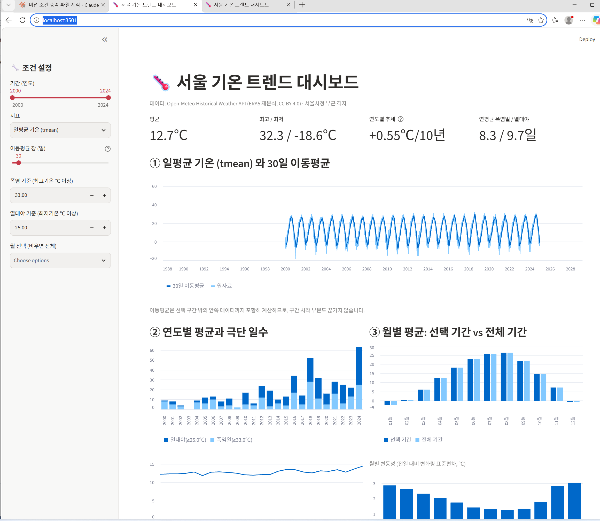
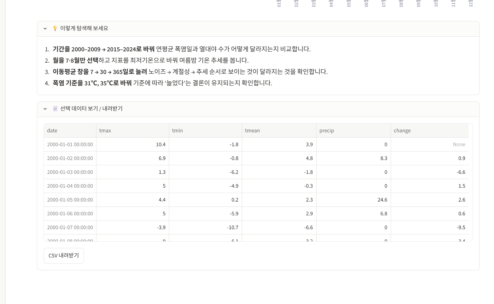

# Streamlit 대시보드 — 실제 증빙 사진과 필터 시연 안내

이 파일은 **대시보드 보너스 과제의 증빙·재현 방법**입니다. `README.md`는 프로젝트 전체 소개이고, 여기서는 웹 화면을 실제로 조작하는 방법에 집중합니다.

## 1. 실행

```powershell
python -m pip install -r requirements.txt
python -m streamlit run dashboard.py
```

주소: `http://localhost:8501` (**로컬 PC에서만 접속**). `data/seoul_weather_2000_2024.csv`가 이미 포함되어 있으므로 처음부터 다시 수집할 필요는 없습니다.

## 2. 제공된 증빙 사진

### 사진 1 — 대시보드 전체 화면



**확인할 것:** 왼쪽 사이드바의 기간·지표·기준 설정과 오른쪽 핵심 지표·그래프 배치를 보여 줍니다.

### 사진 2 — 선택 데이터 표 및 내려받기 기능



**확인할 것:** 분석 결과에 사용된 개별 날짜의 수치를 표로 확인하고 CSV로 내려받을 수 있습니다.

> 위 두 장은 **제공된 실제 캡처**입니다. 아직 촬영하지 않은 필터 변경 장면을 촬영했다고 적지 않았습니다. 평가 기준에서 요구하는 “스크린샷 세트 + 필터/기간 변경 시나리오”는 아래 조작 과정에서 캡처를 추가하면 더욱 명확하게 충족할 수 있습니다.

## 3. 직접 따라 하는 기간·조건 변경 시나리오

| 순서 | 화면에서 조작 | 왜 해보나요? | 추천 캡처 파일명 |
|---|---|---|---|
| 1 | 기본값 2000~2024년 | 전체 기간의 핵심 지표 확인 | `03_all_years.png` |
| 2 | 연도 2000~2009년으로 변경 | 과거 10년의 고온 기준 초과 일수 확인 | `04_period_2000_2009.png` |
| 3 | 연도 2015~2024년으로 변경 | 최근 10년과 비교 | `05_period_2015_2024.png` |
| 4 | 월을 7월·8월만, 지표를 `tmin`으로 변경 | 여름밤 최저기온 추세 확인 | `06_summer_tmin.png` |
| 5 | 이동평균 창을 7일→365일로 변경 | 짧은 변동과 장기 추세의 차이 확인 | `07_window_365.png` |
| 6 | 폭염 기준을 31℃→35℃로 변경 | 분류 기준을 바꾸었을 때 결과가 얼마나 달라지는지 확인 | `08_heat_threshold.png` |

**실제 확인한 결과 수치**를 캡처와 함께 적으면 좋습니다. 사진에 없는 수치를 미리 만들어 적어 두지 않았습니다. 캡처를 저장하면 `docs/images/`에 넣고 이 문서에 이미지 링크를 추가하세요.

## 4. 파일을 다시 실행했는데 화면이 보이지 않는다면?

- `streamlit` 모듈을 찾지 못한다면 `python -m pip install -r requirements.txt`를 다시 확인합니다.
- 입력 CSV가 없다는 오류가 표시되면 `data/seoul_weather_2000_2024.csv`가 있는지 확인합니다.
- `localhost:8501`은 공개 배포 주소가 아니므로 다른 기기에서 동일하게 접속된다고 보장할 수 없습니다.
- `dashboard.py`는 `analysis.py`의 정제 함수를 재사용합니다. 따라서 데이터가 바뀌면 표시값도 달라질 수 있습니다.

## 5. 과제 제출 시 주의 사항

과제는 대시보드 보너스 증빙을 **배포 URL / 로컬 시연 영상+실행법 / 화면 캡처 세트+변경 시나리오** 중 하나로 요구합니다. 현재 보유한 것은 **실제 화면 캡처 2장과 재현·변경 시나리오 안내**입니다. 완전히 다른 조건이 적용된 화면 여러 장이 필요한 평가 환경이라면 위 표대로 촬영을 추가하세요.
