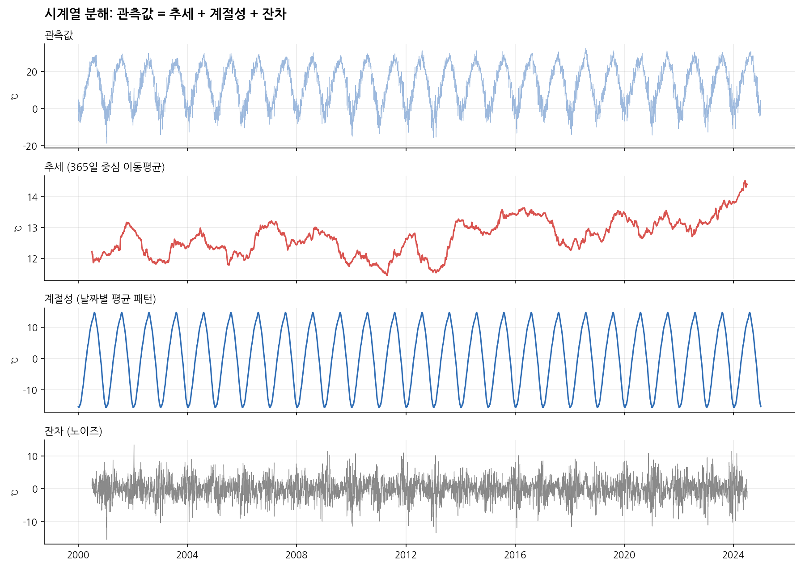

# 보너스 과제 — 시계열 분해를 어떻게 구현하고 해석했나요?

이 프로젝트에는 **시계열 분해 보너스가 이미 구현되어 있습니다.** `analysis.py`의 `decompose()` 함수와 [`images/06_decomposition.png`](../images/06_decomposition.png)가 실제 결과입니다. 새로 처음부터 만들 필요는 없습니다. 아래 내용을 통해 *왜*, *어떻게*, *무엇이 보이는지* 설명할 수 있습니다.

## 1. 목적: 여름·겨울의 반복이 너무 커서 장기 변화를 가리지 않을까?

서울의 하루 평균 기온은 겨울에 낮고 여름에 높습니다. 장기적으로 1℃ 남짓 변화하더라도, 계절에 따라 30℃ 안팎의 차이가 반복되면 일별 그래프에서 장기 변화가 잘 보이지 않습니다. 이를 분리해 확인하기 위해 **가법 시계열 분해(additive time-series decomposition)**를 사용했습니다.

**관측값(Observed) = 추세(Trend) + 계절성(Seasonal) + 잔차(Residual)**

| 성분 | 뜻 | 분석에서 계산하는 방법 | 그래프에서 보는 곳 |
|---|---|---|---|
| 관측값 | 실제 기록된 일평균 기온 | `tmean` 열 | 1번째 |
| 추세 | 상대적으로 천천히 움직이는 중심선 | 365일 **중심 이동평균** | 2번째 |
| 계절성 | 해마다 반복되는 날짜별 패턴 | 추세를 뺀 뒤 1~365일별 평균, 15일 평활화 | 3번째 |
| 잔차 | 앞의 두 성분으로 설명되지 않은 나머지 | `관측값 - 추세 - 계절성` | 4번째 |

## 2. 실제 그래프



**위에서 아래 순서로 읽어 주세요.** 첫 그림에 규칙적으로 보이는 커다란 물결은 주로 계절 변화입니다. 두 번째 그림에서는 오랜 기간의 완만한 변화가 더 눈에 띕니다. 네 번째 그림에서는 그날그날의 예외적인 날씨를 확인할 수 있습니다.

## 3. 왜 365일 주기를 사용했나요?

일별 기온에서는 계절이 **대략 1년마다 반복**되므로 365일을 기준으로 잡았습니다. 이 프로젝트는 직접 만든 함수를 사용하며, 별도의 `statsmodels` 분해 기능을 호출하지 않습니다.

1. `data/seoul_weather_2000_2024.csv`에서 날짜와 평균기온을 읽습니다.
2. 누락·중복·논리 오류를 점검하고 시계열을 날짜순으로 정리합니다.
3. `rolling(365, center=True)`로 1년 중심 이동평균을 구하고 양쪽 끝 약 182일은 제외합니다.
4. 원자료에서 추세를 뺀 후, **1년 중 같은 날짜 위치(1~365)**에 나타나는 값을 여러 해에 걸쳐 평균합니다.
5. 계절 성분은 인접 날짜 15일 평균으로 조금 더 매끄럽게 만들고, 관측값에서 추세와 계절성을 빼 잔차를 계산합니다.
6. 네 성분을 4단 그래프로 표시합니다.

윤년에는 2월 29일을 일반 날짜와 맞추는 단순화가 있으므로, 윤년의 세부 날짜별 계절 패턴에는 작은 오차가 있을 수 있습니다.

## 4. 데이터에서 확인된 결과

| 지표 | 값 | 의미 |
|---|---:|---|
| 계절 성분의 최고–최저 차이 | 약 **30.3℃** | 연중 반복되는 여름·겨울의 온도 차이가 큼 |
| 추세 성분의 최고–최저 차이 | 약 **3.1℃** | 25년 동안 추세선이 움직인 전체 범위 |
| 잔차 성분의 표준편차 | 약 **2.9℃** | 계절·추세만으로는 설명되지 않는 일별 흔들림 |

이 결과로는 **“서울은 계절성이 강해 일별 자료만으로 장기 추세를 식별하기 어렵다”**라고 설명할 수 있습니다. 하지만 계절성이 기온 변화의 '원인'을 밝혀 주거나, 잔차가 모두 단순한 측정 오류라는 뜻은 아닙니다.

## 5. 실제 실행 및 검증

압축을 푼 프로젝트 폴더에서 다음 명령을 실행합니다.

```powershell
python -m pip install -r requirements.txt
python analysis.py
python -m unittest discover -s tests -v
```

분해 코드는 `analysis.py`의 **`decompose()`**, 그래프 저장 코드는 **`plot_decomposition()`**입니다. 분석을 재실행하면 `images/06_decomposition.png`가 갱신되며, `REPORT.md`의 **4-6절**에도 분해 방법과 결과 수치가 나옵니다.

추가한 단위 테스트는 데이터가 9,132행인지, 분해 결과가 원래 시계열과 일치하는지, 4개 성분이 존재하는지 확인합니다. **이 테스트를 통과한다고 해서 해석의 과학적 정확성 전부가 자동 검증되는 것은 아닙니다.**

## 6. 평가자가 물으면 이렇게 설명할 수 있습니다

> “일별 기온은 여름과 겨울의 차이가 워낙 커서, 장기 기온 상승이 그림에서 잘 보이지 않았습니다. 그래서 365일 이동평균으로 장기 추세를 구하고, 매년 반복되는 계절 패턴을 별도로 계산했습니다. 마지막으로 남은 값을 잔차로 나타냈습니다. 네 가지를 한 화면에 나눠 그려 보니 서울 기온에서는 계절성이 크고 장기 추세는 상대적으로 완만하다는 점을 확인할 수 있었습니다. 다만 이 분석만으로 온난화나 도심 열섬의 영향을 분리해 증명할 수는 없습니다.”

## 7. 주의할 점

- ‘고전적 가법 분해’는 추세와 계절 패턴이 더해진다고 가정하는 **탐색적 방법**입니다. 다른 분해법(STL 등)을 쓰면 추정치는 달라질 수 있습니다.
- 365일 중심 평균 때문에 **자료 양쪽 약 반년은 추세·잔차를 계산하기 어렵습니다**. 그래프의 빈 구간은 데이터가 없다는 뜻과 다를 수 있습니다.
- 약 30.3℃(계절 진폭)는 **매년 동일한 실제 여름·겨울 차이**가 아니라, 여러 해를 종합해 추정한 반복 패턴의 범위입니다.
- 새로운 기간의 자료가 추가되면 결과값·그래프·README의 숫자를 다시 확인해야 합니다.
- **필수 과제와 별개인 보너스**이므로, 대시보드를 완성해야 시계열 분해가 인정되는 것은 아닙니다. 과제 안내의 ‘시계열 분해 또는 단순 예측’ 중 하나와 시각화 1개라는 조건에 해당합니다.
